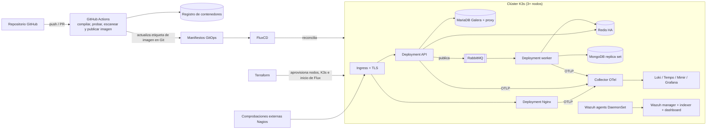

# Plan de migración de plataforma: Kubernetes, colas, IaC, CI/CD, observabilidad y seguridad

Este plan complementa [ToDo.md](./ToDo.md). Describe la migración del stack
basado en Compose (consulta [README.md](./README.md)) a Kubernetes con las
tecnologías que se detallan a continuación. Docker Compose se conserva como
entorno local de desarrollo.

## Estado de la implementación local

La implementación funcional local usa un nodo Minikube en este equipo Linux;
sirve para desarrollo y pruebas, no para alta disponibilidad. Todos los
servicios y datos dependen de este host. El stack Compose y sus volúmenes de
datos se conservan por separado y se detienen (no se eliminan) mientras se
ejecuta Minikube para evitar competir por memoria. El overlay local
ejecuta la web y la API, MariaDB y MongoDB de un solo nodo, RabbitMQ, el worker
de reseñas y Redis descartable, con PVC para las bases de datos y la cola. La
suite smoke de extremo a extremo cubre lecturas frías y calientes del catálogo,
además de escrituras de reseñas asíncronas e idempotentes. Las trazas y métricas
de la API y del navegador pasan por un Collector local de OpenTelemetry hacia
un stack LGTM de desarrollo con recursos limitados. Nginx propaga el contexto
W3C, pero no genera spans propios con la imagen actual.

Esto no es una migración a producción: los datos de Compose no se migraron y
Terraform aplicado, Flux, RabbitMQ/base de datos en alta disponibilidad y LGTM
de producción siguen pendientes. Wazuh es técnicamente posible como demo local,
pero todavía no se instaló: se aplaza hasta medir recursos y configurar de
forma segura el acceso a logs del nodo. Consulta los límites y los componentes
prescindibles del repositorio en [README.md](./README.md) y los comandos en
[deploy/README.md](./deploy/README.md).

## Decisiones tecnológicas

| Área | Elección | Motivo |
|---|---|---|
| Clúster | **K3s** (3 nodos; Minikube solo para smoke tests de un desarrollador) | Ligero, multinodo y con semántica real de alta disponibilidad (etcd integrado). |
| IaC | **Terraform** (compatible con OpenTofu) | Proveedores consolidados para hosts K3s, Helm, Kubernetes y recursos cloud/VM. |
| GitOps | **FluxCD** | Reconcilia de forma pull el estado del clúster desde Git. |
| CI/CD | **GitHub Actions** | El repositorio ya está en GitHub; no requiere otro servidor. |
| Colas | **RabbitMQ** (Cluster Operator) | Colas durables, reintentos y mensajes de descarte; NATS JetStream es la alternativa. |
| Observabilidad | **OpenTelemetry + Grafana LGTM** (Loki, Grafana, Tempo y Mimir) | Unifica logs, métricas y trazas; Nagios se conserva para comprobaciones externas de caja negra. |
| Seguridad | **Wazuh** y controles nativos de Kubernetes | IDS de host/contenedor, FIM, detección de vulnerabilidades y cumplimiento. |

## Arquitectura objetivo



## Casos de uso de colas

1. **Escritura asíncrona de reseñas:** `POST` de reseña → la API valida y
   publica en `reviews.created`; un worker guarda en MongoDB. Se requieren
   claves de idempotencia, reintentos con espera incremental y una cola DLQ
   (`reviews.dlq`).
2. **Invalidación de caché:** los cambios del catálogo publican
   `catalog.changed`; los workers (o los Pods de la API mediante un exchange
   fan-out) eliminan claves acotadas de Redis.
3. **Calentamiento de caché y protección contra estampidas:** un solo worker
   consume `catalog.refresh` y vuelve a llenar la caché, de modo que los
   fallos de caché no consulten todos MariaDB (atiende el punto 4 de ToDo).

## Fases

### Fase 0 – Requisitos previos

- [x] Añadir imágenes versionadas y sin privilegios para `web` y
  `application`, junto con endpoints API `/healthz` y `/readyz`. El overlay
  local aplica ejecución sin privilegios y sistema de archivos de solo lectura
  a esas cargas.
- [x] Mantener las direcciones de dependencias de la API en variables de
  entorno; el overlay de Kubernetes local proporciona sus valores en la
  configuración de las cargas.
- [ ] Elegir registro de imágenes (GHCR) y esquema de etiquetas
  (`sha-<commit>` + semver).

### Fase 1 – IaC con Terraform

- [x] Crear y validar `infra/terraform/` con los módulos `network`,
  `k3s-nodes`, `flux-bootstrap` y `storage`.
- [ ] Aprovisionar tres nodos servidor y verificar K3s con etcd integrado en
  HA y kube-vip para el endpoint del API.
- [x] Mantener estados locales separados para `dev` y `dev-flux` en este equipo;
  excluirlos de Git y protegerlos con permisos de usuario.
- [ ] Elegir un backend remoto con cifrado, versionado y bloqueo antes de
  compartir el estado o definir producción.
- [ ] Iniciar FluxCD mediante el proveedor Terraform de Flux en el clúster
  creado.
- [ ] Ejecutar y hacer pasar `terraform fmt`, `validate`, `tflint` y Checkov
  en CI.
- [x] Alternativa local funcional: perfil Minikube de un nodo para desplegar y
  probar toda la aplicación en este equipo; no proporciona HA.

> **Decisiones tomadas:** para desarrollo se eligió KVM/libvirt local,
> Terraform CLI ejecutado en este equipo y estado local independiente para
> `dev`/`dev-flux`. La configuración está en
> [infra/terraform](./infra/terraform). Aún faltan libvirt en el host, acceso
> del usuario a `/dev/kvm` y la revisión de un plan real. Producción no está
> definida. No se debe ejecutar `apply` ni marcar la fase completa hasta
> resolver esos requisitos y validar el plan.
> El bootstrap inicial de K3s usa `192.168.250.11`; Flux instala kube-vip
> después y habilita la VIP `192.168.250.10`. La implementación local está
> preparada, pero todavía no se ha aplicado ni verificado sobre VMs.

### Fase 2 – Cargas de Kubernetes

- [x] Añadir una base Kustomize y overlay local iniciales para web, API,
  ConfigMaps, Services y servicios de datos independientes de desarrollo.
- [x] Añadir un worker local para reseñas y RabbitMQ; faltan los overlays de
  producción e Ingress.
- [ ] Sustituir HAProxy + Keepalived por Service/Ingress (K3s incluye Traefik)
  y MetalLB para una VIP en bare metal.
- [x] Definir recursos locales, sondas API/web, PodDisruptionBudgets y
  restricciones de distribución por topología.
- [ ] Añadir HPA y políticas de PodDisruptionBudget/topología para producción.
- [ ] Desplegar la capa de datos mediante operadores: MariaDB Operator
  (Galera) con MaxScale/ProxySQL, MongoDB Community Operator (replica set),
  Redis Sentinel/operator y RabbitMQ Cluster Operator.
- [ ] Añadir NetworkPolicies (denegación por defecto y reglas explícitas por
  capa).

### Fase 3 – Colas

- [ ] Desplegar RabbitMQ productivo (3 réplicas, quorum queues y volúmenes
  persistentes) con el Cluster Operator.
- [x] Añadir el publisher local y el worker de reseñas en
  [index.js](./application/index.js) y [worker.js](./application/worker.js);
  el worker y overlay de producción siguen pendientes.
- [x] Versionar exchanges, colas de reintentos y descarte, y el esquema de
  mensajes locales en [review-queues.js](./application/review-queues.js) y
  [review-message.js](./application/review-message.js).
- [ ] Añadir alertas de profundidad de cola, retraso de consumo y DLQ.
- [ ] Escalar workers según profundidad de cola (KEDA, opcional).

### Fase 4 – CI/CD con GitHub Actions

- [x] Añadir un workflow para PR y push con pruebas API, auditoría de
  dependencias API/web, construcción de imágenes y renderizado de Kustomize.
- [ ] Añadir lint, escaneo de imágenes con Trivy, `terraform validate` y
  `kubeconform`.
- [ ] En `main`, `release.yml` debe construir y publicar imágenes en GHCR,
  firmar con cosign, generar SBOM y actualizar la etiqueta en la ruta GitOps
  (o permitir que la automatización de imágenes de Flux lo haga).
- [ ] Usar OIDC para cloud/registro y evitar credenciales de larga duración en
  los secretos del repositorio cuando sea posible.
- [ ] Comentar `terraform plan` en PR; ejecutar `apply` solo desde `main`
  protegido y con aprobación manual.
- [ ] Jenkins queda fuera de alcance salvo que se requiera un servidor
  autogestionado.

### Fase 5 – GitOps con FluxCD

Casos de uso por implementar:

- [ ] **Inicio del clúster:** `clusters/<env>/` contiene los objetos Flux
  `GitRepository` y `Kustomization`; Terraform solo inicia Flux.
- [ ] **Promoción entre entornos:** `dev` sigue `main`; `prod` sigue etiquetas
  o una rama `release`, con la aprobación de PR como control de promoción.
- [ ] **Automatización de imágenes:** `ImageRepository`, `ImagePolicy` e
  `ImageUpdateAutomation` actualizan las etiquetas en Git.
- [ ] **Orden de dependencias:** cadena `dependsOn`: operadores → capa de
  datos → colas → aplicaciones → configuración de observabilidad.
- [ ] **Corrección de drift y reversión:** los cambios manuales con `kubectl`
  se revierten; la reversión se hace con `git revert`.
- [ ] **Secretos:** SOPS (age) o External Secrets con descifrado de Flux.
- [ ] **Notificaciones:** Flux `Provider`/`Alert` para Slack o estado de
  commit en GitHub.

### Fase 6 – Observabilidad (OpenTelemetry + LGTM)

- [x] Ejecutar un backend de desarrollo local `grafana/otel-lgtm` con
  recursos limitados y volumen Docker persistente.
- [x] Aprovisionar un dashboard local de API para tasa de solicitudes,
  latencia p95 y tasa de aciertos de caché del catálogo.
- [ ] Desplegar LGTM de producción con Helm y Flux: Loki, Tempo, Mimir, Grafana
  y Alloy o el Collector OTel como gateway.
- [x] Instrumentar spans/métricas HTTP de la API y exportarlos por OTLP a
  través del Collector local hacia Tempo y Prometheus.
- [ ] Completar instrumentación con OpenTelemetry:
  - [x] API Node.js: HTTP, MySQL2 y MongoDB; se exportan los resultados de
    caché como métrica.
  - [x] Los spans de comandos Redis v5 no registran claves ni valores.
  - [x] Spans AMQP de productor/consumidor con propagación W3C por los
    encabezados de mensajes RabbitMQ.
  - [x] Navegador: instrumentar solicitudes `fetch` con OpenTelemetry Web y
    exportar spans por la ruta del Collector en el mismo origen.
  - [x] Nginx: reenviar `traceparent`/`tracestate` a la API y proxy de
    exportación OTLP. Los spans nativos de Nginx siguen pendientes porque no
    hay un módulo compatible con la imagen Nginx Alpine mantenida y sin
    privilegios.
- [x] Añadir un Deployment Collector OTLP local con sondas, recursos limitados
  y reenvío al backend LGTM local.
- [ ] Collector OTel de producción como DaemonSet (agente) y Deployment
  (gateway): recibe OTLP; envía trazas a Tempo, métricas a Mimir y logs a Loki;
  añade el procesador `k8sattributes`.
- [ ] Completar dashboards RED por servicio, tasa de aciertos de caché, salud
  del clúster Galera, profundidad RabbitMQ y saturación de nodos/Pods. Añadir
  alertas con Grafana/Alertmanager.
- [ ] Definir SLO (p. ej., latencia p95 y disponibilidad) y alertas de
  consumo de presupuesto de error.
- [ ] Mantener Nagios como monitor externo de caja negra (HTTP, vencimiento de
  TLS y conectividad de la API Kubernetes), fuera del clúster, migrando las
  comprobaciones de [architecture.cfg](./nagios/architecture.cfg). Evitar
  duplicar alertas de métricas internas.

### Fase 7 – Seguridad

- [ ] Desplegar Wazuh (manager, indexer y dashboard) con Helm/manifiestos en
  un namespace dedicado; desplegar los agentes Wazuh como DaemonSet en cada
  nodo. Es viable como demo de un nodo, pero aún no se instaló: se pospone
  hasta medir RAM/CPU/disco junto a Minikube y LGTM. La demo no demostraría HA
  ni cobertura de otros equipos; el acceso a logs de host/K3s necesita una
  configuración adicional y debe revisarse antes de montar rutas sensibles.
- [ ] Habilitar FIM, detección de vulnerabilidades, rootcheck, ingesta de
  auditoría de Kubernetes/contenedores y envío de logs de auditoría K3s a
  Wazuh. No está hecho porque Wazuh no está desplegado y el agente dentro de un
  nodo Minikube Docker no observa por sí solo todos los logs del host Linux.
- [ ] Integrar alertas Wazuh con Grafana/Slack; ajustar reglas y respuestas
  activas con cautela.
- [x] Aplicar controles base: namespace con Pod Security Admission `baseline`,
  auditoría/advertencia `restricted`, y contenedores web/API/worker/Collector
  no-root y con filesystem de solo lectura donde corresponde. Los recursos de
  datos aún emiten advertencias `restricted`.
- [ ] Aplicar Pod Security Admission `restricted` de forma obligatoria a todo
  el namespace, completar RBAC mínimo y ejecutar el CIS benchmark con
  kube-bench. No se fuerza `restricted` con los manifiestos actuales: MariaDB
  y MongoDB aún no declaran los contextos necesarios y RabbitMQ prepara el PVC
  local con un init container que usa `CHOWN`. Antes hay que adaptar y volver a
  probar cada Pod, no ignorar las advertencias.
- [ ] Añadir NetworkPolicies por capa y verificar su efecto con el CNI elegido.
  No se consideran protección efectiva hasta probar que el CNI de Minikube/K3s
  las aplica.
- [ ] TLS en Ingress con cert-manager; mTLS entre servicios (malla opcional).
- [ ] Usuarios de mínimo privilegio para MongoDB/Redis/MariaDB; secretos en
  SOPS/External Secrets (atiende el punto 6 de ToDo). Los Secrets actuales
  son archivos locales ignorados y privados, adecuados para desarrollo en este
  host pero no cifrados en Git ni gestionados por Flux.
- [ ] Autenticación de API y limitación de tasa en Ingress.
- [ ] Cadena de suministro: Trivy en CI y verificación de firmas cosign con
  política Kyverno; Dependabot.

> **Límite de alcance:** la fase 7 no es imposible en local. Wazuh puede
> desplegarse como laboratorio opcional de un nodo, pero manager/indexer/
> dashboard compiten por recursos con la tienda y LGTM y no validarían HA ni
> monitorización de varios equipos. Primero debe medirse el consumo disponible;
> es razonable apagar LGTM durante esa demo o ejecutarla en otro entorno local
> aislado. No se debe conceder acceso privilegiado al host o a logs de auditoría
> hasta definir los montajes y permisos mínimos.

### Fase 8 – Migración y validación

- [ ] Ejecutar Compose y K3s en paralelo; migrar tráfico gradualmente mediante
  ponderación DNS.
- [ ] Portar los escenarios de [resilience-lab](./resilience-lab/README.md) a
  Kubernetes (terminación de Pods/nodos con Chaos Mesh o Litmus) y verificar
  los SLO.
- [x] Probar respaldo y restauración aislada de MariaDB, MongoDB y definiciones
  RabbitMQ; no se respaldan los mensajes RabbitMQ.
- [x] Añadir scripts locales de respaldo y verificación de restauración
  aislada; los mensajes RabbitMQ siguen pendientes.
- [ ] Escribir runbooks de despliegue, reversión, pérdida de nodo, acumulación
  de cola e incidentes de seguridad.
- [ ] Retirar HAProxy/Keepalived de la ruta productiva.

## Estructura propuesta del repositorio

```text
infra/terraform/{modules,envs/dev,envs/prod}
clusters/{dev,prod}/            # puntos de entrada de Flux
deploy/{base,overlays/dev,overlays/prod}
deploy/platform/{operators,rabbitmq,observability,wazuh,cert-manager}
worker/                          # consumidor de colas
.github/workflows/{ci.yml,release.yml,terraform.yml}
```

## Orden sugerido

1. Fases 0 y 1 (imágenes, Terraform y K3s).
2. Inicio de Flux (fase 5) para gestionar el resto mediante Git.
3. Fase 2 (aplicaciones sin estado y luego operadores de datos).
4. Fase 4 (CI/CD) en paralelo con la fase 2.
5. Fase 6 (OTel + LGTM) antes de incorporar colas, para que estas sean
   observables desde el principio.
6. Fase 3 (RabbitMQ + worker).
7. Fase 7 (Wazuh y endurecimiento), seguida de la fase 8 de migración.
