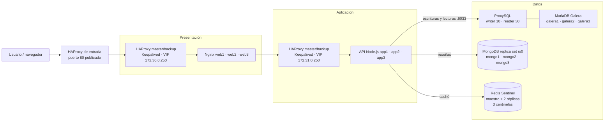

# Sistema distribuido de tres capas

Proyecto académico para la materia **Sistemas Distribuidos**. Tienda web distribuida
con balanceo en presentación y aplicación, almacenamiento relacional y NoSQL, y
caché de catálogo.

**Integrantes:** Javier Rodriguez Rodriguez y Adriana Dzib De la Rosa  
**Docente:** Ismael Jiménez Sánchez — **Tarea:** #995

## Arquitectura

Docker Compose en un solo host: dos pares HAProxy master/backup con Keepalived,
tres nodos web Nginx, tres nodos API Node.js, tres MariaDB Galera detrás de
ProxySQL, replica set MongoDB de tres nodos y Redis con maestro, dos réplicas y
tres centinelas.

### Diagrama



### Responsabilidades

- **Presentación:** HAProxy distribuye entre `web1-3`; Keepalived administra la VIP.
- **Aplicación:** HAProxy distribuye entre `app1-3`; la API ofrece catálogo, reseñas y salud.
- **Datos:** MariaDB Galera almacena el catálogo (ProxySQL enruta); MongoDB `rs0` almacena reseñas; Redis conserva el catálogo más barato durante `CATALOG_CACHE_TTL_SECONDS` (60 s). Si Redis cae, el catálogo se sirve desde MariaDB.

### Alcance y límites

La API usa `DB_HOST=proxysql` (no `galera1`), ProxySQL promueve otro writer si el actual falla. MongoDB y Redis tienen alta disponibilidad local con failover automático. Todo corre en un solo host: **no** protege contra la caída del host, de Docker Desktop, de `presentation-entry` ni de la red local. El objetivo es tolerar la caída de réplicas y procesos dentro del mismo host.

### Objetivos

- **Resiliencia:** el sistema tolera la caída de réplicas de API, nodos Galera, primario de MongoDB y maestro de Redis sin interrumpir el servicio; el catálogo se sirve desde MariaDB si Redis no responde.
- **Alta disponibilidad:** ProxySQL promueve automáticamente otro writer de Galera; MongoDB elige otro primario; Sentinel promueve otra réplica de Redis; HAProxy retira nodos caídos del balanceo.
- **Escalabilidad:** el pool de conexiones se parametriza con `DB_POOL_SIZE` por réplica de API; al escalar réplicas se comprueba que `N × DB_POOL_SIZE` no supere los límites de ProxySQL y MariaDB.

### Mejoras de la capa de datos (implementadas)

Las 7 mejoras solicitadas están implementadas y verificadas:

| # | Mejora | Estado |
|---|---|---|
| 1 | MongoDB replica set / gestionado | ✅ Implementado y verificado |
| 2 | Redis HA / gestionado | ✅ Implementado y verificado |
| 3 | Redis descartable | ✅ Implementado y verificado |
| 4 | Eliminar conexión directa a `galera1` | ✅ Implementado y verificado |
| 5 | Proxy DB-aware | ✅ Implementado y verificado |
| 6 | Enrutamiento lectura/escritura en Galera | ✅ Implementado y verificado |
| 7 | Límites del pool al escalar réplicas | ✅ Implementado y verificado |

## Capa de datos

### ProxySQL (MariaDB)

La API y `catalog-init` se conectan a `proxysql:6033`. ProxySQL monitorea el estado `wsrep` y clasifica los nodos:

| Grupo | Uso |
|---|---|
| `10` | Writer (un nodo Synced/Primary) |
| `20` | Backup writer |
| `30` | Reader (nodos sincronizados) |
| `40` | Offline |

`SELECT ... FOR UPDATE` y las escrituras van al grupo `10`; los `SELECT` simples al `30`. Si el writer falla, ProxySQL promueve otro nodo sin cambiar la configuración de la API. Panel de administración: `proxysql:6032` (solo red interna).

### MongoDB replica set (`rs0`)

Tres miembros: `mongo1` (prioridad 2), `mongo2` y `mongo3` (prioridad 1), con keyfile compartido. `catalog-init` crea el usuario `store_app` limitado a `store_reviews`. La API usa `MONGO_HOSTS=mongo1,mongo2,mongo3` y `MONGO_REPLICA_SET=rs0`; el driver descubre al primario y tolera la caída de un nodo. Si el primario se detiene, se elige otro y las reseñas siguen respondiendo. La conexión se intenta en segundo plano; si falla, el cliente se reemplaza para reconectar cuando MongoDB vuelva. `/api/health` marca `mongodb: unavailable` mientras tanto y las reseñas responden `503`, sin afectar el catálogo.

### Redis Sentinel (caché descartable)

Maestro, dos réplicas y tres centinelas con quórum 2. La API se conecta a `redis-sentinel1/2/3:26379` y descubre al maestro (`mymaster`); si el maestro cae, Sentinel promueve una réplica. Redis no usa AOF ni RDB: la caché se reconstruye desde MariaDB. Los centinelas monitorean la IP fija `172.32.0.11` (Docker elimina el DNS de un contenedor detenido y Sentinel entraría en `TILT`). `REDIS_COMMAND_TIMEOUT_MS` (2 s por defecto) limita cada comando de caché; si Redis no responde, el catálogo se lee de MariaDB. `POST /api/cache/clear` devuelve `503` si Redis no está disponible.

### Pool de conexiones

`DB_POOL_SIZE` es el límite por réplica de API. Con 3 réplicas, el máximo es `3 × DB_POOL_SIZE` conexiones, además del monitoreo de ProxySQL. ProxySQL limita al usuario de aplicación a `max_connections=200` y cada servidor Galera a `max_connections=30`.

| Variable | Default | Efecto |
|---|---|---|
| `DB_POOL_SIZE` | 10 | Conexiones por réplica de API |
| `DB_POOL_IDLE_TIMEOUT_MS` | 60000 | Cierre de conexiones inactivas |
| `DB_CONNECT_TIMEOUT_MS` | 5000 | Límite para abrir una conexión |
| `REDIS_COMMAND_TIMEOUT_MS` | 2000 | Límite por comando de caché |
| `CATALOG_CACHE_TTL_SECONDS` | 60 | TTL del catálogo |

## Acceso desde una segunda laptop

El host ejecuta Docker Compose; la otra laptop actúa como **cliente de prueba**. El puerto 80 publicado por Docker se consume usando la IP LAN del host (por ejemplo `http://<IP_HOST>/`), no `localhost`. La IP puede cambiar entre sesiones: consúltela en el host con `ipconfig | findstr /i "IPv4"`.

### Cuándo se necesita el firewall

Docker publica el puerto 80 en `0.0.0.0` por defecto, por lo que el tráfico de la LAN llega al contenedor. **Solo se necesita una regla de firewall si Windows bloquea el tráfico entrante** (interfaz clasificada como `Public`). Si `Test-NetConnection` devuelve `TcpTestSucceeded: True`, no hace falta ninguna regla.

Para verificar conectividad desde el cliente:

```powershell
Test-NetConnection <IP_HOST> -Port 80
```

Si devuelve `False`, crea una regla restringida (sustituye las IP y el nombre de interfaz por los de tu red):

```powershell
$hostIp = "<IP_HOST>"
$clienteIp = "<IP_CLIENTE>"
$interfaz = "Wi-Fi"
$perfil = (Get-NetConnectionProfile -InterfaceAlias $interfaz).NetworkCategory
New-NetFirewallRule -DisplayName "Distributed Store HTTP test" -Direction Inbound -Protocol TCP -LocalPort 80 -LocalAddress $hostIp -RemoteAddress $clienteIp -InterfaceAlias $interfaz -Action Allow -Profile $perfil
```

No abras TCP/80 a toda una red pública ni cambies el perfil de red a `Private` solo para la PoC. Nagios está publicado únicamente en `127.0.0.1:8088` y no es accesible desde la LAN.

### Pasos para probar desde el cliente

1. Levanta el stack en el host: `docker compose --env-file .env.exam up --build -d`
2. En el host, obtén su IP LAN: `ipconfig | findstr /i "IPv4"`
3. Desde el cliente, verifica: `Test-NetConnection <IP_HOST> -Port 80`
4. Abre en el navegador del cliente: `http://<IP_HOST>/`
5. Verifica la API: `curl.exe -i http://<IP_HOST>/api/health`

Las pruebas que detienen o inician contenedores se ejecutan en el host; la carga y las comprobaciones HTTP se hacen desde el cliente.

## Ejecución en Windows

**Requisitos:** Windows 10/11 con Docker Desktop, Docker Compose v2, PowerShell, puertos 80 y 8088 libres.

1. Abre PowerShell en la raíz del repositorio.
2. Levanta el stack con las credenciales de demostración:

```powershell
docker compose --env-file .env.exam up --build -d
docker compose --env-file .env.exam ps
```

3. Revisa logs si algún servicio falla:

```powershell
docker compose --env-file .env.exam logs --tail 100 catalog-init db-bootstrap mongo-init proxysql app1 app2 app3 galera1 galera2 galera3 mongo1 mongo2 mongo3 redis-master redis-sentinel1
```

4. Accede a la tienda en `http://localhost/` y a la API en `http://localhost/api/health`.

`galera1` usa `galera/entrypoint.sh` para decidir si arranca el clúster o se une a uno existente:

1. Si no hay datos, hace bootstrap de un clúster nuevo.
2. Si `safe_to_bootstrap=1`, fue el último en salir del componente primario y puede hacer bootstrap.
3. Si hay datos y ningún par responde como `Primary` en 30 s, fuerza el bootstrap (`MARIADB_GALERA_FORCE_SAFETOBOOTSTRAP=yes`). Así un apagado brusco del equipo no deja el clúster bloqueado.
4. Si algún par ya es `Primary`, se une a ese clúster.

`galera2` y `galera3` arrancan con `condition: service_started` y `restart: always`, de modo que se unen solos en cuanto `galera1` es primario. Los tres nodos tienen `stop_grace_period: 60s` para favorecer un cierre limpio.

> **Riesgo del bootstrap forzado:** `galera1` es el nodo de recuperación designado. Si su dato fuera más antiguo que el de un par, el bootstrap forzado perdería esas transacciones. En un solo host con los tres nodos detenidos a la vez esto no ocurre, porque los tres comparten el mismo instante de apagado. Si sospechas de datos divergentes, respalda los volúmenes y recupera la posición con `wsrep-recover` (ver `ToDo.md`) en lugar de confiar en el fallback.

Keepalived corre en sidecars que comparten el namespace de red de cada HAProxy. `keepalived/keepalived-entrypoint.sh` busca la interfaz por su IP esperada, renderiza el config con el nombre actual y reinicia Keepalived si Docker la renombra (`eth0` → `veth...`). Si tras 60 s no encuentra la interfaz, el contenedor sale con error para que Docker lo recree y se reenganche al namespace del HAProxy.

### Después de reiniciar Docker Desktop

Con la configuración actual **no hace falta reparar nada a mano**. Al reiniciar Docker Desktop o el equipo:

1. Docker arranca solo todos los servicios con `restart: always` (incluidos `web1`, `web2`, `web3` y `nagios`). A diferencia de `unless-stopped`, `always` también los levanta si se habían detenido con `docker compose stop` antes del reinicio.
2. `galera1` espera 30 s a un par `Primary`; si no lo hay, hace bootstrap y `galera2`/`galera3` se unen.
3. Los sidecars de Keepalived detectan la interfaz y levantan el VIP sin intervención.
4. Las IPs fijas de Redis (`172.32.0.11`–`.16`) están fuera del rango dinámico (`ip_range: 172.32.0.128/25`), así que ningún contenedor puede quedarse con la IP de `redis-master` mientras está detenido.

Espera 60-90 s tras el reinicio y verifica:

```powershell
docker compose --env-file .env.exam ps
curl.exe -sS http://localhost/api/health
docker exec distributed-three-tier-galera1-1 mariadb -u root -pchange-this-root-password -e "SHOW STATUS LIKE 'wsrep_cluster_size'; SHOW STATUS LIKE 'wsrep_cluster_status';"
```

Debes ver todos los servicios `Up` (o `healthy`), `{"status":"ok",...}` y `wsrep_cluster_size = 3` con `wsrep_cluster_status = Primary`.

**Si algo no vuelve** (por ejemplo, un `curl: (52) Empty reply from server` o un `503`):

```powershell
# 0. Qué está realmente caído (Created/Exited incluidos)
docker compose --env-file .env.exam ps -a

# 1. Si hay contenedores en Created o Exited, levántalos
docker compose --env-file .env.exam up -d

# 2. Si web1-3 no están arriba, levántalos primero
docker compose --env-file .env.exam up -d web1 web2 web3

# 3. Recrea los HAProxy y luego los sidecars de Keepalived
docker compose --env-file .env.exam up -d --force-recreate --no-deps presentation-lb-master presentation-lb-backup application-lb-master application-lb-backup
docker compose --env-file .env.exam up -d --force-recreate --no-deps presentation-keepalived-master presentation-keepalived-backup application-keepalived-master application-keepalived-backup

# 4. Si Galera no formó el clúster
docker compose --env-file .env.exam up -d --no-deps galera2 galera3

# 5. Si cambiaste código de la app o el init falla con variables faltantes
docker compose --env-file .env.exam up -d --build
```

**Diagnóstico de un `503 Service Unavailable`:** el `503` con `server: nginx` y `No server is available to handle this request` lo genera nginx (`web1-3`) cuando el VIP de aplicación (`172.31.0.250:8080`) no tiene backend. Comprueba en este orden:

```powershell
docker compose --env-file .env.exam ps -a | Select-String "app1|app2|app3"
docker run --rm --network distributed-three-tier_application curlimages/curl:latest -sS -o NUL -w "app VIP %{http_code}`n" http://172.31.0.250:8080/health
docker logs --tail 20 distributed-three-tier-application-lb-master-1
```

Si los tres `app` están `Exited`, levántalos con `up -d app1 app2 app3`. Si HAProxy muestra `application_nodes/<NOSRV>`, todos los backends están marcados DOWN y el problema está en los `app`, no en HAProxy.

Para apagar de forma ordenada antes de suspender el equipo, usa `Stop-Stack.ps1`
(ver [Apagado y arranque](#apagado-y-arranque)). No uses `docker compose down`
salvo que vayas a ejecutar `Start-Stack.ps1` al volver: `down` elimina los
contenedores y `restart: always` no puede recrearlos. `down -v` borra los
volúmenes y es destructivo.

## Cómo se ejecutan las PoC

Todas las PoC siguen el mismo reparto de roles:

- **Cliente (segunda laptop):** genera las solicitudes HTTP, observa la traza
  `X-Request-Trace` y captura los resultados.
- **Host (Docker):** ejecuta el script que provoca la falla y la restaura.

El cliente **no** ejecuta Docker. El host **no** genera la carga. Así la prueba
demuestra el comportamiento real de la LAN.

### Antes de empezar (checklist)

1. En el host, confirma que el stack está listo:

   ```powershell
   powershell -NoProfile -ExecutionPolicy Bypass -File .\PoCs\Test-StackHealth.ps1
   ```

   Debe terminar con `LISTO para la demo (9 comprobaciones)`.

2. Obtén la IP LAN del host:

   ```powershell
   ipconfig | findstr /i "IPv4"
   ```

3. En el cliente, comprueba la conectividad:

   ```powershell
   Test-NetConnection <IP_HOST> -Port 80
   curl.exe -i http://<IP_HOST>/api/health
   ```

   Si `Test-NetConnection` devuelve `False`, aplica la regla de firewall del
   [README de PoCs](PoCs/README.md#firewall-del-host).

4. Abre dos terminales: una en el **cliente** y otra en el **host**.

## PoC 1: prueba de carga desde el cliente

**Objetivo:** medir latencia y throughput del catálogo con caché fría y caliente,
y observar qué pasa al aumentar la concurrencia.

**Reparto de roles:** el host solo vacía la caché; el cliente genera toda la
carga.

### En el host: vaciar la caché

```powershell
curl.exe -sS -o NUL -w "cache_clear HTTP %{http_code}`n" -X POST http://localhost/api/cache/clear
```

### En el cliente: medir caché fría y caliente

```powershell
# Caché fría: la primera solicitud consulta MariaDB y escribe en Redis
powershell -NoProfile -ExecutionPolicy Bypass -File .\PoCs\Invoke-LoadTest.ps1 `
  -BaseUrl "http://<IP_HOST>" -Requests 1 -Concurrency 1

# Caché caliente
powershell -NoProfile -ExecutionPolicy Bypass -File .\PoCs\Invoke-LoadTest.ps1 `
  -BaseUrl "http://<IP_HOST>" -Requests 500 -Concurrency 20
```

Si quieres ver el punto de saturación, repite la carga caliente con
`-Concurrency 10` y `-Concurrency 50`. El script imprime solicitudes,
concurrencia, duración, req/s, latencia media, p50/p95/p99, errores y códigos
HTTP. No hace falta instalar `ab` ni ninguna otra herramienta.

### Qué capturar

| Escenario | Solicitudes | Concurrencia | Fallidas | Req/s | Tiempo medio |
|---|---|---|---|---|---|
| Caché fría | 1 | 1 | | | |
| Caché caliente | 500 | 20 | | | |
| Caché caliente (opcional) | 500 | 50 | | | |

Guarda la salida completa en `PoCs/evidencias/poc1-carga-<fecha>.txt`.

**Qué deberías observar:** la caché fría tarda más porque consulta MariaDB; la
caliente baja la latencia y sube el throughput. Al aumentar la concurrencia, el
throughput se estabiliza y la latencia sube: el cuello de botella está en las
réplicas API y el balanceo, no en Redis.

## PoC 2: failover por capas

**Objetivo:** comprobar, desde el cliente, que el sistema sigue respondiendo
cuando falla:

1. un nodo API,
2. el HAProxy master de presentación,
3. el HAProxy master de aplicación.

Los tres failover se prueban **dentro de esta misma PoC**, en orden, con un solo
script en el host.

**Reparto de roles:** el cliente monitoriza; el host ejecuta
`Test-LanFailover.ps1 -Layer All`.

### En el cliente: iniciar el monitor

```powershell
powershell -NoProfile -ExecutionPolicy Bypass -File .\PoCs\Monitor-LanHealth.ps1 `
  -HostIPv4 "<IP_HOST>" -RequestCount 120 -IntervalMilliseconds 500
```

Son 120 sondeos cada 500 ms (unos 60 s), suficientes para toda la PoC 2. El
monitor imprime el estado HTTP, la traza y un resumen final de disponibilidad.

### En el host: ejecutar la PoC 2 completa

```powershell
powershell -NoProfile -ExecutionPolicy Bypass -File .\PoCs\Test-LanFailover.ps1 `
  -Layer All -HoldSeconds 12
```

El script ejecuta tres fases:

| Fase | Qué hace | Qué debe verse en la traza del cliente |
|---|---|---|
| 1. API | detiene `app1` durante `HoldSeconds` y lo restaura | `app1` desaparece; responden `app2`/`app3` |
| 2. Presentación | **pausa** `presentation-lb-master` y lo reanuda | `presentation-lb-backup` y luego vuelve el master |
| 3. Aplicación | **pausa** `application-lb-master` y lo reanuda | `application-lb-backup` y luego vuelve el master |

Los HAProxy se **pausan**, no se detienen: el sidecar Keepalived comparte su
*network namespace* y pausar conserva ese namespace para que el VIP pueda
migrar al backup. Cada fase restaura lo que cambió en un bloque `finally`,
incluso si pulsas `Ctrl+C`.

Si quieres probar una sola capa:

```powershell
.\PoCs\Test-LanFailover.ps1 -Layer Api
.\PoCs\Test-LanFailover.ps1 -Layer Presentation
.\PoCs\Test-LanFailover.ps1 -Layer Application
```

Para revisar sin tocar nada: añade `-WhatIf`.

### Qué capturar

En el cliente, guarda la salida del monitor. En el host, guarda el resumen del
script. Una tabla útil:

| Fase | Traza antes | Cambio observado | Tiempo de failover | Vuelta al master | HTTP 200 / errores |
|---|---|---|---|---|---|
| API (`app1`) | | | | | |
| Presentación | | | | | |
| Aplicación | | | | | |

Archivos sugeridos:

- `PoCs/evidencias/poc2-failover-cliente-<fecha>.txt`
- `PoCs/evidencias/poc2-failover-host-<fecha>.txt`

**Qué deberías observar:** durante la convergencia puede haber uno o dos
timeouts; después el servicio sigue respondiendo con las réplicas o el backup.
El cliente no cambia de URL: siempre usa `http://<IP_HOST>/api/health`.

## PoC 3: Chaos Engineering

**Objetivo:** inyectar una falla aleatoria en una réplica API durante 15 s y
medir la disponibilidad desde el cliente con un monitor continuo.

**Reparto de roles:** el cliente monitoriza; el host elige y tumba un nodo al
azar.

### En el cliente: iniciar el monitor

```powershell
powershell -NoProfile -ExecutionPolicy Bypass -File .\PoCs\Monitor-LanHealth.ps1 `
  -HostIPv4 "<IP_HOST>" -RequestCount 70 -IntervalMilliseconds 500
```

Son 70 sondeos cada 500 ms (unos 35 s).

### En el host: inyectar la falla

```powershell
powershell -NoProfile -ExecutionPolicy Bypass -File .\PoCs\Invoke-ChaosTest.ps1 `
  -HoldSeconds 15
```

El script elige `app1`, `app2` o `app3` al azar, lo detiene 15 s y **siempre** lo
restaura en un bloque `finally`, incluso si pulsas `Ctrl+C`. Después espera a que
HAProxy lo marque `UP` y lo confirma con la línea
`Server application_nodes/appN is UP`.

Si quieres controlar el nodo:

```powershell
.\PoCs\Invoke-ChaosTest.ps1 -Target app2 -HoldSeconds 15
```

Para revisar sin tocar nada: añade `-WhatIf`.

### Qué capturar

| Nodo | Ventana de falla | Sondeos | HTTP 200 | Errores | Disponibilidad | Vuelta a rotación |
|---|---|---|---|---|---|---|
| | | | | | | |

Guarda la salida del monitor y la del host en
`PoCs/evidencias/poc3-chaos-cliente-<fecha>.txt` y
`PoCs/evidencias/poc3-chaos-host-<fecha>.txt`.

**Qué deberías observar:** la mayoría de los sondeos siguen siendo `HTTP 200`
con `app2`/`app3`; los errores se concentran en la ventana de convergencia de
HAProxy. El nodo vuelve a la rotación cuando se restaura.

## Apagado y arranque

### Apagar antes de cerrar el equipo

En el host, desde la raíz del repositorio:

```powershell
powershell -NoProfile -ExecutionPolicy Bypass -File .\Stop-Stack.ps1
```

`Stop-Stack.ps1` ejecuta `docker compose stop`, que envía `SIGTERM` y respeta
`stop_grace_period` (60 s en Galera, 45 s en MongoDB, 20 s en las API). Los
contenedores **no se eliminan**: al volver a arrancar Docker, `restart: always`
los levanta solos.

Opcionalmente, detén también Docker Desktop:

```powershell
.\Stop-Stack.ps1 -StopDockerDesktop
```

Comprueba que todo quedó detenido:

```powershell
docker compose --env-file .env.exam ps -a
```

Todos los servicios de larga duración deben aparecer como `Exited (0)`. Los
*one-shot* (`db-bootstrap`, `catalog-init`, `mongo-init`, `mongo-keyfile-init`)
también aparecen `Exited (0)`: es su estado normal.

**No uses `docker compose down`** salvo que vayas a ejecutar `Start-Stack.ps1`
al volver. `down` elimina los contenedores y `restart: always` no puede
recrearlos. **Nunca uses `down -v`** si quieres conservar los datos: borra los
volúmenes de Galera y MongoDB.

### Arrancar de nuevo

```powershell
powershell -NoProfile -ExecutionPolicy Bypass -File .\Start-Stack.ps1
```

Espera a Docker, ejecuta `docker compose up -d` y valida con
`Test-StackHealth.ps1`. Sale con `0` solo si el stack está listo. El log queda en
`PoCs/evidencias/start-stack.log`.

### Arranque automático al iniciar sesión

1. En Docker Desktop, activa **Settings → General → Start Docker Desktop when
   you sign in**.
2. Instala el arranque automático del stack:

   ```powershell
   powershell -NoProfile -ExecutionPolicy Bypass -File .\Install-AutoStart.ps1
   ```

   Crea un acceso en la carpeta *Startup* del usuario. Alternativas:

   ```powershell
   # Usar el Programador de tareas
   .\Install-AutoStart.ps1 -UseScheduledTask

   # Quitar el arranque automático
   .\Install-AutoStart.ps1 -Remove

   # Probarlo ahora
   .\Install-AutoStart.ps1 -StartNow
   ```

### Si algo no vuelve

```powershell
# Ver qué está caído, incluidos Created/Exited
docker compose --env-file .env.exam ps -a

# Recrear lo que falte
docker compose --env-file .env.exam up -d

# Verificar de nuevo
powershell -NoProfile -ExecutionPolicy Bypass -File .\PoCs\Test-StackHealth.ps1
```

Si el problema persiste, revisa los logs del servicio con
`docker logs <servicio>` y consulta la sección de diagnóstico de
[Ejecución en Windows](#ejecución-en-windows).

## Dónde guardar los resultados

Este README **no incluye resultados**: los captura el operador durante la demo.
Guarda las salidas en `PoCs/evidencias/`, que está excluida de Git salvo su
propio README. Así puedes pegar texto, CSV o capturas sin ensuciar el
repositorio.

Para cada PoC, la sección **Qué capturar** indica las columnas mínimas. Lo
importante es conservar:

- la salida del **cliente** (HTTP, traza, req/s o disponibilidad),
- la salida del **host** (qué se detuvo o pausó, tiempos y restauración),
- la fecha y la IP del host usada en esa ejecución.

## Scripts de la demo

| Script | Dónde se ejecuta | Para qué |
|---|---|---|
| `PoCs/Test-StackHealth.ps1` | Host | Readiness: Docker, 29 servicios, API, catálogo, traza, Galera, VIPs y Nagios. |
| `PoCs/Invoke-LoadTest.ps1` | Cliente | Carga HTTP de la PoC 1: req/s, latencias y errores. |
| `PoCs/Monitor-LanHealth.ps1` | Cliente | Monitor continuo de `/api/health` para las PoC 2 y 3. |
| `PoCs/Test-LanFailover.ps1` | Host | PoC 2: failover de API, presentación y aplicación. |
| `PoCs/Invoke-ChaosTest.ps1` | Host | PoC 3: falla aleatoria de un nodo API con restauración garantizada. |
| `PoCs/Enable-LanPocFirewall.ps1` | Host (admin) | Crea o actualiza la regla TCP/80 para el cliente. |
| `PoCs/Remove-LanPocFirewall.ps1` | Host (admin) | Elimina la regla de firewall de la PoC. |
| `Start-Stack.ps1` | Host | Arranque ordenado y verificación del stack. |
| `Stop-Stack.ps1` | Host | Apagado ordenado antes de cerrar el equipo. |
| `Install-AutoStart.ps1` | Host | Arranque automático al iniciar sesión. |
