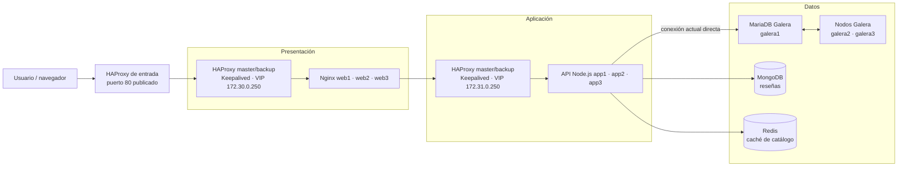

# Sistema distribuido de tres capas

Proyecto académico para la materia **Sistemas Distribuidos**. El equipo diseñó
una tienda web distribuida con balanceo en las capas de presentación y
aplicación, almacenamiento relacional y NoSQL, y una caché para el catálogo.

**Integrantes:** Javier Rodriguez Rodriguez y Adriana Dzib De la Rosa

**Docente:** Ismael Jiménez Sánchez

**Tarea:** #995

## Arquitectura

La infraestructura se ejecuta con Docker Compose en un solo host. Incluye dos
pares HAProxy master/backup con Keepalived, tres nodos web Nginx, tres nodos API
Node.js, tres nodos MariaDB Galera, una instancia MongoDB y una instancia
Redis.

### Diagrama JPG

**Pendiente del equipo:** insertar aquí la imagen JPG exportada desde Lucidchart
(por ejemplo, `docs/arquitectura.jpg`). El diagrama Mermaid siguiente sirve
como referencia mientras se agrega el archivo final.

<!-- INSERTAR:  -->



### Responsabilidad de las capas

- **Presentación:** HAProxy distribuye las solicitudes entre `web1`, `web2` y
  `web3`. Keepalived administra una VIP entre los HAProxy.
- **Aplicación:** HAProxy distribuye las solicitudes entre `app1`, `app2` y
  `app3`. La API ofrece catálogo, reseñas y estado de salud.
- **Datos:** MariaDB Galera almacena el catálogo; MongoDB almacena las reseñas;
  Redis conserva la respuesta de productos más baratos durante el TTL
  configurado en `CATALOG_CACHE_TTL_SECONDS` (60 segundos por defecto).

### Alcance actual

Los tres nodos MariaDB forman un clúster Galera, pero actualmente la API y el
inicializador se conectan directamente a `galera1`. Tener replicación Galera
no hace que el cliente distribuya sus conexiones: si `galera1` falla, la
aplicación no cambia automáticamente a `galera2` o `galera3`. MongoDB y Redis
son instancias únicas. Además, todo Compose se ejecuta en un solo host; esta
demostración no ofrece alta disponibilidad ante la caída de ese host.

### Acceso desde el segundo equipo

El equipo que ejecuta Docker Compose es el **host del servicio**; las otras
computadoras de la misma red local actúan como **clientes de prueba**. El puerto
80 publicado por Docker se consume usando la dirección IPv4 LAN del host, por
ejemplo `http://192.168.1.50/`, no usando `localhost`: en el segundo equipo,
`localhost` se refiere a ese propio equipo.

1. Conecta ambos equipos a la misma red local y levanta el proyecto en el host:

    ```powershell
    docker compose --env-file .env.exam up --build -d
    ```

2. En el host, consulta su dirección IPv4 con `ipconfig`. Usa la dirección de
    la interfaz conectada a la misma red que el equipo cliente (por ejemplo,
    `192.168.1.50`; no uses `127.0.0.1`). Para filtrar las direcciones IPv4:

    ```powershell
    ipconfig | findstr /i "IPv4"
    ```

3. Desde el segundo equipo, comprueba que el puerto web del host es alcanzable,
    sustituyendo la IP de ejemplo:

    ```powershell
    Test-NetConnection 192.168.1.50 -Port 80
    ```

    Si `TcpTestSucceeded` es `False`, comprueba que Docker sigue activo, que
    ambos equipos están en la misma LAN y revisa el perfil de la interfaz con
    `Get-NetConnectionProfile`. En una LAN privada de confianza, si hace falta,
    un administrador puede permitir TCP/80 solo entre las IP del host y del
    cliente por la interfaz conectada. Cambia las direcciones y el nombre de
    interfaz del ejemplo; no cambies el perfil de red solo para la PoC:

    ```powershell
    $hostIp = "192.168.1.50"
    $clienteIp = "192.168.1.25"
    $interfaz = "Wi-Fi"
    $perfil = (Get-NetConnectionProfile -InterfaceAlias $interfaz).NetworkCategory
    New-NetFirewallRule -DisplayName "Distributed Store HTTP test" -Direction Inbound -Protocol TCP -LocalPort 80 -LocalAddress $hostIp -RemoteAddress $clienteIp -InterfaceAlias $interfaz -Action Allow -Profile $perfil
    ```

    No abras TCP/80 a toda una red pública ni cambies el perfil de una Wi-Fi
    pública solo para ejecutar la PoC. Si la interfaz aparece como `Public`,
    usa esta regla únicamente en una LAN privada de confianza y mantenla
    restringida a la IP del cliente.

4. Abre en el navegador del segundo equipo `http://192.168.1.50/`, usando la
    IP real del host. La API también se puede verificar desde ese equipo en
    `http://192.168.1.50/api/health`.

Conviene reservar la IP del host en el router o verificarla antes de cada
sesión. El proyecto y Docker Compose se ejecutan en un solo host; el equipo
cliente no necesita iniciar otra copia del stack. Las pruebas que detienen o
inician contenedores se ejecutan en el host, mientras la carga y las
comprobaciones HTTP se hacen desde el cliente. Nagios está publicado únicamente
en `127.0.0.1:8088` y no es accesible desde la LAN.

La PoC LAN realizada el 22-10-2026, con resultados, scripts reutilizables de
monitorización/failover y gestión restringida de firewall, está en
[poc/2026-10-22-lan-failover](./poc/2026-10-22-lan-failover/README.md). Sus
resultados corresponden a esa ejecución; repite las comprobaciones antes de
asumir que las IP o el perfil de red siguen iguales.

El puerto 80 está publicado en `presentation-entry`, que reenvía las solicitudes
a la VIP Docker `172.30.0.250`. Keepalived mueve esa VIP entre
`presentation-lb-master` y `presentation-lb-backup`, por lo que el acceso desde
la IP LAN puede probar el failover de esos balanceadores. La VIP no se publica
directamente en la LAN. `presentation-entry` y el host Docker siguen siendo
puntos únicos de falla; esta configuración no ofrece alta disponibilidad ante
la caída del host.

Para probar la conmutación sin reemplazar el namespace de red, pausa y reanuda
el HAProxy desde otra terminal mientras se hacen solicitudes:

```powershell
docker compose --env-file .env.exam pause presentation-lb-master
docker compose --env-file .env.exam unpause presentation-lb-master
```

El chequeo de Keepalived exige ahora una respuesta HTTP 200, de modo que
también detecta un HAProxy pausado o que no responde a HTTP. Si se usa
`docker compose stop` y luego `start` sobre un HAProxy, Docker puede recrear su
namespace de red; en ese caso reinicia también su sidecar Keepalived para que
se asocie al namespace activo:

```powershell
docker compose --env-file .env.exam start presentation-lb-master
docker compose --env-file .env.exam restart presentation-keepalived-master
```

Para la capa de aplicación, sustituye `presentation-lb-master` y
`presentation-keepalived-master` por `application-lb-master` y
`application-keepalived-master`.

## Requisitos

- Windows 10/11 con Docker Desktop iniciado y el motor de contenedores Linux.
- Docker Compose v2 (`docker compose`).
- PowerShell.
- Puertos locales 80 y 8088 disponibles.
- Para la PoC de carga: ApacheBench (`ab`) instalado, o JMeter.

## Ejecución en Windows

Abre PowerShell en la carpeta raíz del repositorio. El archivo `.env.exam`
incluido en el proyecto contiene valores de demostración para el entorno local.
No agregues contraseñas reales a ese archivo ni las publiques. Para usar
credenciales propias, crea un archivo local ignorado por Git (por ejemplo,
`.env.local`) y reemplaza `.env.exam` por `.env.local` en los comandos
`docker compose --env-file`:

```powershell
notepad .env.local
```

Contenido inicial de `.env.local`:

```dotenv
MARIADB_ROOT_PASSWORD=change-this-root-password
MARIADB_BACKUP_PASSWORD=change-this-backup-password
CATALOG_DB_NAME=store
CATALOG_DB_USER=store_app
CATALOG_DB_PASSWORD=change-this-catalog-password
MONGO_DB_NAME=store_reviews
MONGO_ROOT_USERNAME=store_admin
MONGO_ROOT_PASSWORD=change-this-mongodb-password
MONGO_APP_USERNAME=store_app
MONGO_APP_PASSWORD=change-this-mongodb-app-password
CATALOG_CACHE_TTL_SECONDS=60
NAGIOSADMIN_PASSWORD=change-this-nagios-password
```

Reemplaza todas las contraseñas de ejemplo por valores propios. No publiques
`.env.local` ni uses las credenciales de demostración de `.env.exam` en un
servidor compartido. Para iniciar el entorno incluido en el proyecto, construye
y levanta todos los servicios:

```powershell
docker compose --env-file .env.exam up --build -d
docker compose --env-file .env.exam ps
```

La primera ejecución puede tardar mientras Docker descarga imágenes y Galera
se inicializa. Confirma que los servicios estén iniciados y revisa los logs si
alguno falla:

```powershell
docker compose --env-file .env.exam logs --tail 100 catalog-init app1 app2 app3 galera1 galera2 galera3
```

Si `galera1` se niega a iniciar porque `safe_to_bootstrap=0`, no borres los
volúmenes ni fuerces el bootstrap: podrías perder transacciones. Respalda los
tres volúmenes y recupera la posición con `wsrep-recover` en cada nodo; solo
debe iniciar el nodo con la secuencia recuperada más alta. Después inicia los
pares y confirma que los tres nodos estén saludables y sincronizados. Si las
posiciones difieren o no puedes determinar el nodo más avanzado, detén la
recuperación y conserva los respaldos.

Keepalived corre en sidecars que comparten el namespace de red de cada HAProxy.
Después de reconstruirlos o iniciarlos, confirma que los cuatro sidecars sigan
activos en `docker compose ps`; un ciclo de reinicios indica que la VIP no está
lista para las PoC.

Direcciones desde el host Docker:

- Tienda: <http://localhost/>
- API de salud: <http://localhost/api/health>
- Productos más baratos: <http://localhost/api/products/cheapest>
- Reseñas de `ST-001`: <http://localhost/api/products/ST-001/reviews>
- Nagios: <http://localhost:8088/> (usuario `nagiosadmin`; contraseña del archivo de entorno seleccionado)

Desde el otro equipo, sustituye `localhost` por la IP LAN del host, por
ejemplo `http://192.168.1.50/` y `http://192.168.1.50/api/health`.

La tienda muestra la ruta de las solicitudes. El encabezado `X-Request-Trace`
identifica los balanceadores, nodos y almacenes involucrados. El endpoint
`POST /api/cache/clear` elimina la entrada de caché del catálogo.
La API se conecta a MongoDB con un usuario limitado a lectura y escritura en la
base `store_reviews`; `catalog-init` usa la cuenta administrativa solo para
crear o actualizar ese usuario durante la inicialización. La duración de la
caché del catálogo se configura con `CATALOG_CACHE_TTL_SECONDS` (60 segundos
por defecto). Las peticiones simultáneas a una caché vacía comparten una sola
carga desde MariaDB.

Para detener los contenedores sin borrar los datos persistidos:

```powershell
docker compose --env-file .env.exam down
```

Para borrar también los volúmenes de MariaDB y MongoDB y reiniciar los datos
desde cero, usa `docker compose --env-file .env.exam down -v`. Esta operación
es destructiva.

## PoC 1: Prueba de carga

**Objetivo:** medir la respuesta del endpoint de catálogo bajo concurrencia y
comprobar que la API continúa respondiendo. Ejecútala con el sistema levantado
y comienza con una carga moderada.

En el equipo cliente, define la dirección LAN del host Docker y ejecuta
ApacheBench (`ab`) desde allí. Sustituye la IP del ejemplo por la dirección
obtenida con `ipconfig` en el host:

```powershell
$baseUrl = "http://192.168.1.50"
ab -n 500 -c 20 "$baseUrl/api/products/cheapest"
```

`-n` indica el total de solicitudes y `-c` la concurrencia. Para medir una
petición de caché fría, elimina la entrada primero y ejecuta una sola vez con
`-c 1`; para medir caché caliente, repite la prueba normal:

```powershell
$baseUrl = "http://192.168.1.50"
Invoke-RestMethod -Method Post -Uri "$baseUrl/api/cache/clear"
ab -n 1 -c 1 "$baseUrl/api/products/cheapest"
ab -n 500 -c 20 "$baseUrl/api/products/cheapest"
```

Si no tienes `ab`, crea un plan en JMeter con un grupo de hilos, el endpoint
`GET /api/products/cheapest`, una carga inicial de 20 usuarios y 500 iteraciones,
y un listener de resumen. No aumentes la carga sin vigilar CPU, memoria y logs.

**Registrar en el informe:** herramienta y versión, fecha, concurrencia,
solicitudes completadas, solicitudes fallidas, tiempo medio, percentiles y
solicitudes por segundo. No se incluyen resultados hasta que el equipo ejecute
la prueba en su entorno.

**Espacio para resultados:**

> Pendiente: agregar tabla, captura de ApacheBench/JMeter y análisis de los
> resultados obtenidos por el equipo.

## PoC 2: Failover simple

**Objetivo:** comprobar que el HAProxy de aplicación deja de enviar tráfico a
un nodo API detenido y continúa usando las réplicas disponibles.

1. En el equipo cliente, define la dirección LAN del host y confirma que el
    endpoint responde:

   ```powershell
    $baseUrl = "http://192.168.1.50"
    curl.exe -i "$baseUrl/api/health"
   ```

2. En una terminal PowerShell del host Docker, detén temporalmente un nodo API:

   ```powershell
   docker compose --env-file .env.exam stop app1
   ```

3. Desde el equipo cliente, espera unos segundos a que HAProxy detecte el nodo
    inactivo y consulta de nuevo. La respuesta debe ser `200`; el encabezado
    `X-Request-Trace` debe mostrar `app2` o `app3` como nodo de aplicación:

   ```powershell
    curl.exe -i "$baseUrl/api/health"
   ```

4. En el host Docker, recupera el servicio. Confirma desde el cliente que volvió
    a responder:

   ```powershell
   docker compose --env-file .env.exam start app1
   ```

    ```powershell
    curl.exe -i "$baseUrl/api/health"
    ```

**Criterio de éxito:** las solicitudes siguen recibiendo HTTP 200 durante la
caída de `app1`, atendidas por los nodos API restantes, y el servicio detenido
se puede iniciar de nuevo. Guarda los encabezados y las horas de cada paso.

Esta PoC prueba la tolerancia a la caída de una réplica API, no la alta
disponibilidad del host ni el failover del puerto 80 publicado por Docker.

## PoC 3: Chaos Engineering con Chaos Monkey

**Objetivo:** inyectar desde el host una falla controlada en una réplica API y
comprobar desde el equipo cliente la hipótesis de que el servicio mantiene
disponibilidad con las otras réplicas.

**Compatibilidad:** Netflix Chaos Monkey está pensado para entornos gestionados
por Spinnaker y grupos de instancias en la nube; no está integrado ni se puede
ejecutar directamente sobre este proyecto Docker Compose. No se debe reportar
la prueba siguiente como una ejecución de Netflix Chaos Monkey. Es un
experimento local de inyección de fallas inspirado en Chaos Monkey, usando
Docker Compose.

En el host Docker, ejecuta el bloque desde la raíz del repositorio. Selecciona
al azar una réplica, la detiene durante 15 segundos y siempre intenta
restaurarla. Durante esa ventana, ejecuta comprobaciones desde el equipo
cliente con la PoC de failover anterior, apuntando a la IP LAN del host.

```powershell
$target = Get-Random -InputObject @("app1", "app2", "app3")
Write-Host "Nodo seleccionado: $target"
docker compose --env-file .env.exam stop $target
try {
    Write-Host "Falla inyectada por 15 segundos; ejecutar sondeos desde el cliente."
    Start-Sleep -Seconds 15
}
finally {
    docker compose --env-file .env.exam start $target
}
```

**Límites y seguridad:** realiza esta prueba solo en el entorno local, nunca en
una instalación compartida o productiva. No detengas Galera, MongoDB, Redis ni
los balanceadores en este experimento inicial. Si una solicitud falla,
registra el resultado y verifica la recuperación con
`docker compose --env-file .env.exam ps` en el host y
`curl.exe -i http://192.168.1.50/api/health`
desde el cliente (sustituye la IP por la del host Docker).

**Espacio para resultados:**

> Pendiente: documentar hipótesis, nodo afectado, duración, errores observados,
> evidencia de recuperación y conclusiones del equipo. Para usar Netflix Chaos
> Monkey real, se requiere migrar/desplegar la infraestructura en una plataforma
> compatible con Spinnaker y documentar esa configuración por separado.

## Documentación y evidencias

Este README y los archivos Markdown del repositorio constituyen la
documentación del proyecto. El equipo debe completar los espacios pendientes
con el diagrama JPG exportado y las evidencias reales de las PoC antes de
presentar resultados como ejecutados.