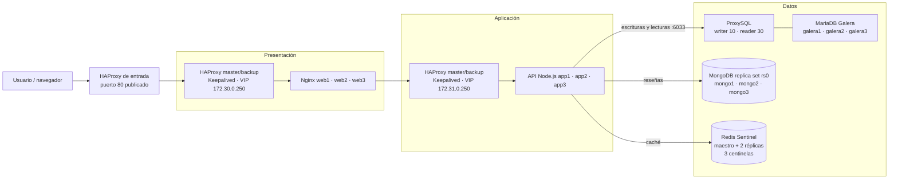

# Sistema distribuido de tres capas

Proyecto académico para la materia **Sistemas Distribuidos**. Tienda web distribuida
con balanceo en presentación y aplicación, almacenamiento relacional y NoSQL, y
caché de catálogo.

**Integrantes:** Javier Rodriguez Rodriguez y Adriana Dzib De la Rosa  
**Docente:** Ismael Jiménez Sánchez — **Tarea:** #995

## Arquitectura

Docker Compose en un solo host: dos pares HAProxy master/backup con Keepalived,
tres nodos web Nginx, tres nodos API Node.js, tres MariaDB Galera detrás de
ProxySQL, replica set MongoDB de tres nodos y Redis con maestro, dos réplicas y
tres centinelas.

### Diagrama



### Responsabilidades

- **Presentación:** HAProxy distribuye entre `web1-3`; Keepalived administra la VIP.
- **Aplicación:** HAProxy distribuye entre `app1-3`; la API ofrece catálogo, reseñas y salud.
- **Datos:** MariaDB Galera almacena el catálogo (ProxySQL enruta); MongoDB `rs0` almacena reseñas; Redis conserva el catálogo más barato durante `CATALOG_CACHE_TTL_SECONDS` (60 s). Si Redis cae, el catálogo se sirve desde MariaDB.

### Alcance y límites

La API usa `DB_HOST=proxysql` (no `galera1`), ProxySQL promueve otro writer si el actual falla. MongoDB y Redis tienen alta disponibilidad local con failover automático. Todo corre en un solo host: **no** protege contra la caída del host, de Docker Desktop, de `presentation-entry` ni de la red local. El objetivo es tolerar la caída de réplicas y procesos dentro del mismo host.

### Objetivos

- **Resiliencia:** el sistema tolera la caída de réplicas de API, nodos Galera, primario de MongoDB y maestro de Redis sin interrumpir el servicio; el catálogo se sirve desde MariaDB si Redis no responde.
- **Alta disponibilidad:** ProxySQL promueve automáticamente otro writer de Galera; MongoDB elige otro primario; Sentinel promueve otra réplica de Redis; HAProxy retira nodos caídos del balanceo.
- **Escalabilidad:** el pool de conexiones se parametriza con `DB_POOL_SIZE` por réplica de API; al escalar réplicas se comprueba que `N × DB_POOL_SIZE` no supere los límites de ProxySQL y MariaDB.

### Mejoras de la capa de datos (implementadas)

Las 7 mejoras solicitadas están implementadas y verificadas:

| # | Mejora | Estado |
|---|---|---|
| 1 | MongoDB replica set / gestionado | ✅ Implementado y verificado |
| 2 | Redis HA / gestionado | ✅ Implementado y verificado |
| 3 | Redis descartable | ✅ Implementado y verificado |
| 4 | Eliminar conexión directa a `galera1` | ✅ Implementado y verificado |
| 5 | Proxy DB-aware | ✅ Implementado y verificado |
| 6 | Enrutamiento lectura/escritura en Galera | ✅ Implementado y verificado |
| 7 | Límites del pool al escalar réplicas | ✅ Implementado y verificado |

**Resultados de failover (23-10-2026):**

| Falla | Resultado |
|---|---|
| Writer Galera `galera3` detenido | ProxySQL promovió `galera2`; escritura insertó 1 fila; catálogo en 200. Al reiniciar, `galera3` recuperó el writer y `size=3`, `Synced`, `Primary`. |
| Primario MongoDB `mongo1` detenido | `mongo2` elegido primario; GET reviews 200, POST 201. Al reiniciar, `mongo1` volvió como primario. |
| Maestro Redis `redis-master` detenido | Sentinel promovió `172.32.0.12`; health `degraded`, catálogo `redis (unavailable) -> mariadb`, cache clear `503`. Al reiniciar, health `ok`. |
| Todos los Redis detenidos | Health `degraded`, catálogo 200 desde MariaDB, cache clear 503. Tras reiniciar, health `ok` y catálogo repobló caché. |
| `galera1` detenido y reiniciado solo | `galera/entrypoint.sh` detectó datos con `safe_to_bootstrap=0` y lo unió al clúster; `wsrep_cluster_size` volvió a 3. |
| MongoDB caído al arrancar `app1` | `app1` arrancó en `degraded` (reseñas 503). Al volver `rs0`, health `ok` y reseñas 200 sin reiniciar la API. |

## Capa de datos

### ProxySQL (MariaDB)

La API y `catalog-init` se conectan a `proxysql:6033`. ProxySQL monitorea el estado `wsrep` y clasifica los nodos:

| Grupo | Uso |
|---|---|
| `10` | Writer (un nodo Synced/Primary) |
| `20` | Backup writer |
| `30` | Reader (nodos sincronizados) |
| `40` | Offline |

`SELECT ... FOR UPDATE` y las escrituras van al grupo `10`; los `SELECT` simples al `30`. Si el writer falla, ProxySQL promueve otro nodo sin cambiar la configuración de la API. Panel de administración: `proxysql:6032` (solo red interna).

### MongoDB replica set (`rs0`)

Tres miembros: `mongo1` (prioridad 2), `mongo2` y `mongo3` (prioridad 1), con keyfile compartido. `catalog-init` crea el usuario `store_app` limitado a `store_reviews`. La API usa `MONGO_HOSTS=mongo1,mongo2,mongo3` y `MONGO_REPLICA_SET=rs0`; el driver descubre al primario y tolera la caída de un nodo. Si el primario se detiene, se elige otro y las reseñas siguen respondiendo. La conexión se intenta en segundo plano; si falla, el cliente se reemplaza para reconectar cuando MongoDB vuelva. `/api/health` marca `mongodb: unavailable` mientras tanto y las reseñas responden `503`, sin afectar el catálogo.

### Redis Sentinel (caché descartable)

Maestro, dos réplicas y tres centinelas con quórum 2. La API se conecta a `redis-sentinel1/2/3:26379` y descubre al maestro (`mymaster`); si el maestro cae, Sentinel promueve una réplica. Redis no usa AOF ni RDB: la caché se reconstruye desde MariaDB. Los centinelas monitorean la IP fija `172.32.0.11` (Docker elimina el DNS de un contenedor detenido y Sentinel entraría en `TILT`). `REDIS_COMMAND_TIMEOUT_MS` (2 s por defecto) limita cada comando de caché; si Redis no responde, el catálogo se lee de MariaDB. `POST /api/cache/clear` devuelve `503` si Redis no está disponible.

### Pool de conexiones

`DB_POOL_SIZE` es el límite por réplica de API. Con 3 réplicas, el máximo es `3 × DB_POOL_SIZE` conexiones, además del monitoreo de ProxySQL. ProxySQL limita al usuario de aplicación a `max_connections=200` y cada servidor Galera a `max_connections=30`.

| Variable | Default | Efecto |
|---|---|---|
| `DB_POOL_SIZE` | 10 | Conexiones por réplica de API |
| `DB_POOL_IDLE_TIMEOUT_MS` | 60000 | Cierre de conexiones inactivas |
| `DB_CONNECT_TIMEOUT_MS` | 5000 | Límite para abrir una conexión |
| `REDIS_COMMAND_TIMEOUT_MS` | 2000 | Límite por comando de caché |
| `CATALOG_CACHE_TTL_SECONDS` | 60 | TTL del catálogo |

## Acceso desde una segunda laptop

El host ejecuta Docker Compose; la otra laptop actúa como **cliente de prueba**. El puerto 80 publicado por Docker se consume usando la IP LAN del host (por ejemplo, en la ejecución del 26-10-2026 fue `http://192.168.1.72/`), no `localhost`. La IP puede cambiar entre sesiones: consúltela en el host con `ipconfig | findstr /i "IPv4"`.

### Cuándo se necesita el firewall

Docker publica el puerto 80 en `0.0.0.0` por defecto, por lo que el tráfico de la LAN llega al contenedor. **Solo se necesita una regla de firewall si Windows bloquea el tráfico entrante** (interfaz clasificada como `Public`). Si `Test-NetConnection` devuelve `TcpTestSucceeded: True`, no hace falta ninguna regla.

Para verificar conectividad desde el cliente:

```powershell
Test-NetConnection <IP_HOST> -Port 80
```

Si devuelve `False`, crea una regla restringida (sustituye las IP y el nombre de interfaz por los de tu red):

```powershell
$hostIp = "<IP_HOST>"
$clienteIp = "<IP_CLIENTE>"
$interfaz = "Wi-Fi"
$perfil = (Get-NetConnectionProfile -InterfaceAlias $interfaz).NetworkCategory
New-NetFirewallRule -DisplayName "Distributed Store HTTP test" -Direction Inbound -Protocol TCP -LocalPort 80 -LocalAddress $hostIp -RemoteAddress $clienteIp -InterfaceAlias $interfaz -Action Allow -Profile $perfil
```

No abras TCP/80 a toda una red pública ni cambies el perfil de red a `Private` solo para la PoC. Nagios está publicado únicamente en `127.0.0.1:8088` y no es accesible desde la LAN.

### Pasos para probar desde el cliente

1. Levanta el stack en el host: `docker compose --env-file .env.exam up --build -d`
2. En el host, obtén su IP LAN: `ipconfig | findstr /i "IPv4"`
3. Desde el cliente, verifica: `Test-NetConnection <IP_HOST> -Port 80`
4. Abre en el navegador del cliente: `http://<IP_HOST>/`
5. Verifica la API: `curl.exe -i http://<IP_HOST>/api/health`

Las pruebas que detienen o inician contenedores se ejecutan en el host; la carga y las comprobaciones HTTP se hacen desde el cliente.

## Ejecución en Windows

**Requisitos:** Windows 10/11 con Docker Desktop, Docker Compose v2, PowerShell, puertos 80 y 8088 libres.

1. Abre PowerShell en la raíz del repositorio.
2. Levanta el stack con las credenciales de demostración:

```powershell
docker compose --env-file .env.exam up --build -d
docker compose --env-file .env.exam ps
```

3. Revisa logs si algún servicio falla:

```powershell
docker compose --env-file .env.exam logs --tail 100 catalog-init db-bootstrap mongo-init proxysql app1 app2 app3 galera1 galera2 galera3 mongo1 mongo2 mongo3 redis-master redis-sentinel1
```

4. Accede a la tienda en `http://localhost/` y a la API en `http://localhost/api/health`.

`galera1` usa `galera/entrypoint.sh` para decidir si arranca el clúster o se une a uno existente:

1. Si no hay datos, hace bootstrap de un clúster nuevo.
2. Si `safe_to_bootstrap=1`, fue el último en salir del componente primario y puede hacer bootstrap.
3. Si hay datos y ningún par responde como `Primary` en 30 s, fuerza el bootstrap (`MARIADB_GALERA_FORCE_SAFETOBOOTSTRAP=yes`). Así un apagado brusco del equipo no deja el clúster bloqueado.
4. Si algún par ya es `Primary`, se une a ese clúster.

`galera2` y `galera3` arrancan con `condition: service_started` y `restart: always`, de modo que se unen solos en cuanto `galera1` es primario. Los tres nodos tienen `stop_grace_period: 60s` para favorecer un cierre limpio.

> **Riesgo del bootstrap forzado:** `galera1` es el nodo de recuperación designado. Si su dato fuera más antiguo que el de un par, el bootstrap forzado perdería esas transacciones. En un solo host con los tres nodos detenidos a la vez esto no ocurre, porque los tres comparten el mismo instante de apagado. Si sospechas de datos divergentes, respalda los volúmenes y recupera la posición con `wsrep-recover` (ver `ToDo.md`) en lugar de confiar en el fallback.

Keepalived corre en sidecars que comparten el namespace de red de cada HAProxy. `keepalived/keepalived-entrypoint.sh` busca la interfaz por su IP esperada, renderiza el config con el nombre actual y reinicia Keepalived si Docker la renombra (`eth0` → `veth...`). Si tras 60 s no encuentra la interfaz, el contenedor sale con error para que Docker lo recree y se reenganche al namespace del HAProxy.

### Después de reiniciar Docker Desktop

Con la configuración actual **no hace falta reparar nada a mano**. Al reiniciar Docker Desktop o el equipo:

1. Docker arranca solo todos los servicios con `restart: always` (incluidos `web1`, `web2`, `web3` y `nagios`). A diferencia de `unless-stopped`, `always` también los levanta si se habían detenido con `docker compose stop` antes del reinicio.
2. `galera1` espera 30 s a un par `Primary`; si no lo hay, hace bootstrap y `galera2`/`galera3` se unen.
3. Los sidecars de Keepalived detectan la interfaz y levantan el VIP sin intervención.
4. Las IPs fijas de Redis (`172.32.0.11`–`.16`) están fuera del rango dinámico (`ip_range: 172.32.0.128/25`), así que ningún contenedor puede quedarse con la IP de `redis-master` mientras está detenido.

Espera 60-90 s tras el reinicio y verifica:

```powershell
docker compose --env-file .env.exam ps
curl.exe -sS http://localhost/api/health
docker exec distributed-three-tier-galera1-1 mariadb -u root -pchange-this-root-password -e "SHOW STATUS LIKE 'wsrep_cluster_size'; SHOW STATUS LIKE 'wsrep_cluster_status';"
```

Debes ver todos los servicios `Up` (o `healthy`), `{"status":"ok",...}` y `wsrep_cluster_size = 3` con `wsrep_cluster_status = Primary`.

**Si algo no vuelve** (por ejemplo, un `curl: (52) Empty reply from server` o un `503`):

```powershell
# 0. Qué está realmente caído (Created/Exited incluidos)
docker compose --env-file .env.exam ps -a

# 1. Si hay contenedores en Created o Exited, levántalos
docker compose --env-file .env.exam up -d

# 2. Si web1-3 no están arriba, levántalos primero
docker compose --env-file .env.exam up -d web1 web2 web3

# 3. Recrea los HAProxy y luego los sidecars de Keepalived
docker compose --env-file .env.exam up -d --force-recreate --no-deps presentation-lb-master presentation-lb-backup application-lb-master application-lb-backup
docker compose --env-file .env.exam up -d --force-recreate --no-deps presentation-keepalived-master presentation-keepalived-backup application-keepalived-master application-keepalived-backup

# 4. Si Galera no formó el clúster
docker compose --env-file .env.exam up -d --no-deps galera2 galera3

# 5. Si cambiaste código de la app o el init falla con variables faltantes
docker compose --env-file .env.exam up -d --build
```

**Diagnóstico de un `503 Service Unavailable`:** el `503` con `server: nginx` y `No server is available to handle this request` lo genera nginx (`web1-3`) cuando el VIP de aplicación (`172.31.0.250:8080`) no tiene backend. Comprueba en este orden:

```powershell
docker compose --env-file .env.exam ps -a | Select-String "app1|app2|app3"
docker run --rm --network distributed-three-tier_application curlimages/curl:latest -sS -o NUL -w "app VIP %{http_code}`n" http://172.31.0.250:8080/health
docker logs --tail 20 distributed-three-tier-application-lb-master-1
```

Si los tres `app` están `Exited`, levántalos con `up -d app1 app2 app3`. Si HAProxy muestra `application_nodes/<NOSRV>`, todos los backends están marcados DOWN y el problema está en los `app`, no en HAProxy.

Para apagar de forma ordenada antes de suspender el equipo:

```powershell
docker compose --env-file .env.exam stop
```

`docker compose stop` envía `SIGTERM` y respeta `stop_grace_period`, lo que permite a Galera cerrar limpio. Con `restart: always`, esos contenedores vuelven solos en el siguiente arranque de Docker. Para detener sin borrar datos: `docker compose --env-file .env.exam down`. Para borrar volúmenes: `docker compose --env-file .env.exam down -v` (destructivo). Redis no tiene volúmenes de persistencia: al recrear sus contenedores la caché arranca vacía.

## PoC 1: Prueba de carga

**Objetivo:** medir latencia y throughput del catálogo con caché fría y caliente, y observar el punto de saturación de las tres réplicas API.

**Herramienta:** ApacheBench (`ab`) dentro de un contenedor `httpd:alpine` conectado a la red `edge`. No hace falta instalar `ab` en el host ni en el cliente.

**En el host**, desde la raíz del repositorio:

```powershell
# 1. Vaciar la caché de Redis
curl.exe -sS -o NUL -w "cache_clear HTTP %{http_code}`n" -X POST http://localhost/api/cache/clear

# 2. Caché fría: la primera solicitud va a MariaDB y escribe en Redis
docker run --rm --network distributed-three-tier_edge httpd:alpine `
  ab -n 1 -c 1 http://presentation-entry/api/products/cheapest

# 3. Caché caliente con tres niveles de concurrencia
docker run --rm --network distributed-three-tier_edge httpd:alpine `
  ab -n 500 -c 10 http://presentation-entry/api/products/cheapest
docker run --rm --network distributed-three-tier_edge httpd:alpine `
  ab -n 500 -c 20 http://presentation-entry/api/products/cheapest
docker run --rm --network distributed-three-tier_edge httpd:alpine `
  ab -n 500 -c 50 http://presentation-entry/api/products/cheapest
```

**Desde el cliente**, si prefiere ejecutar `ab` localmente, sustituya `http://presentation-entry` por `http://<IP_HOST>` (por ejemplo `http://192.168.1.72`). La IP del host cambia entre sesiones: consúltela con `ipconfig | findstr /i "IPv4"`.

Si el cliente no tiene `ab`, use el script incluido (no requiere instalar nada):

```powershell
# Caché fría (ejecutar antes en el host: POST /api/cache/clear)
powershell -NoProfile -ExecutionPolicy Bypass -File .\PoCs\Invoke-LoadTest.ps1 `
  -BaseUrl "http://<IP_HOST>" -Requests 1 -Concurrency 1

# Caché caliente
powershell -NoProfile -ExecutionPolicy Bypass -File .\PoCs\Invoke-LoadTest.ps1 `
  -BaseUrl "http://<IP_HOST>" -Requests 500 -Concurrency 20
```

El script imprime solicitudes, concurrencia, req/s, latencia media, p50/p95/p99, errores y códigos HTTP.

**Resultados (26-10-2026, host `192.168.1.72`):**

| Escenario | Solicitudes | Concurrencia | Fallidas | Req/s | Tiempo medio |
|---|---|---|---|---|---|
| Caché fría (Redis vacío) | 1 | 1 | 0 | 33.53 | 29.821 ms |
| Caché caliente | 500 | 10 | 0 | 870.70 | 11.485 ms |
| Caché caliente | 500 | 20 | 0 | 1021.77 | 19.574 ms |
| Caché caliente | 500 | 50 | 0 | 946.70 | 52.815 ms |

**Lectura:** el impacto de la caché es claro: la primera solicitud tarda 29.8 ms porque consulta MariaDB y escribe en Redis; con la caché caliente la latencia baja a ~11 ms. El throughput se estabiliza alrededor de **1 000 req/s** con tres réplicas API: subir la concurrencia de 20 a 50 no aumenta las solicitudes por segundo y sí multiplica la latencia (19.6 ms → 52.8 ms). El cuello de botella está en las réplicas API y el balanceo, no en Redis. Para escalar hay que agregar réplicas API y revisar que `N × DB_POOL_SIZE` siga dentro de los límites de ProxySQL y MariaDB (mejora 7).

## PoC 2: Failover simple

**Objetivo:** comprobar que HAProxy de aplicación retira un nodo API detenido y sigue atendiendo con los nodos restantes.

**Paso 1 — En el cliente**, medir la línea base (tres sondeos):

```powershell
$baseUrl = "http://192.168.1.72"
1..3 | ForEach-Object {
    curl.exe -sS -i "$baseUrl/api/health" |
        Select-String -Pattern "^HTTP/|^x-request-trace:"
    Start-Sleep -Milliseconds 500
}
```

**Paso 2 — En el host**, detener `app1`:

```powershell
docker compose --env-file .env.exam stop app1
```

**Paso 3 — En el cliente**, sondear durante la convergencia (ocho sondeos, uno por segundo):

```powershell
1..8 | ForEach-Object {
    curl.exe -sS -i --max-time 5 "$baseUrl/api/health" |
        Select-String -Pattern "^HTTP/|^x-request-trace:"
    Start-Sleep -Seconds 1
}
```

**Paso 4 — En el host**, recuperar el nodo:

```powershell
docker compose --env-file .env.exam up -d --no-deps app1
docker compose --env-file .env.exam ps app1
```

`up -d --no-deps` arranca solo `app1`. `docker compose start` también relanza
`db-bootstrap`, `mongo-init` y `catalog-init`, lo que alarga la prueba sin
aportar nada. Espera ~8 s antes de sondear: HAProxy necesita dos chequeos
correctos (`rise 2`) para devolverlo a la rotación.

**Paso 5 — En el cliente**, confirmar que `app1` vuelve a la rotación:

```powershell
1..6 | ForEach-Object {
    curl.exe -sS -i "$baseUrl/api/health" |
        Select-String -Pattern "^HTTP/|^x-request-trace:"
    Start-Sleep -Milliseconds 700
}
```

**Resultados (26-10-2026):**

| Fase | Resultado |
|---|---|
| Línea base (3 sondeos) | 3/3 `HTTP 200`; trazas `app3`, `app1`, `app2` (rotación completa) |
| Convergencia (8 sondeos, 1 s) | 6/8 `HTTP 200`; 2 timeouts de ~5 s en los primeros 8 s |
| Estado estable con `app1` caído (10 sondeos) | 10/10 `HTTP 200`, atendidos solo por `app2` y `app3` |
| Tras recuperar `app1` (6 sondeos) | 6/6 `HTTP 200`; vuelve la rotación `app1`, `app2`, `app3` |

**Lectura:** HAProxy retira el nodo caído y el servicio sigue disponible con las réplicas restantes. Hay una ventana transitoria de unos 8 s (el intervalo de health check) en la que las solicitudes que aún se enrutan a `app1` terminan en timeout. No es un failover sin interrupción: es un failover con errores transitorios acotados a la convergencia.

## PoC 3: Chaos Engineering

**Objetivo:** inyectar una falla aleatoria en una réplica API durante 15 s y medir la disponibilidad desde el cliente con un monitor continuo.

**Paso 1 — En el cliente**, abrir una terminal y lanzar el monitor (70 sondeos cada 500 ms, ~35 s):

```powershell
powershell -NoProfile -ExecutionPolicy Bypass -File .\PoCs\Monitor-LanHealth.ps1 `
  -HostIPv4 "192.168.1.72" -RequestCount 70 -IntervalMilliseconds 500
```

> `-ExecutionPolicy Bypass` solo aplica a esa invocación; no cambia la política del equipo. Si el monitor se ejecuta en el host, use `-HostIPv4 "127.0.0.1"`.

**Paso 2 — En el host**, en otra terminal, inyectar la falla en un nodo aleatorio:

```powershell
powershell -NoProfile -ExecutionPolicy Bypass -File .\PoCs\Invoke-ChaosTest.ps1 `
  -HoldSeconds 15
```

El script elige un nodo al azar, lo detiene 15 s y **siempre** lo restaura en un
bloque `finally` (incluso si pulsas `Ctrl+C`). Después espera a que HAProxy lo
marque `UP` y lo confirma con la línea `Server application_nodes/appN is UP`.

Si prefieres controlar el nodo:

```powershell
powershell -NoProfile -ExecutionPolicy Bypass -File .\PoCs\Invoke-ChaosTest.ps1 `
  -Target app2 -HoldSeconds 15
```

Para revisar sin tocar nada: añade `-WhatIf`.

**Paso 3 — En el host**, confirmar que el nodo volvió:

```powershell
docker compose --env-file .env.exam ps --format "table {{.Service}}\t{{.Status}}" |
  Select-String -Pattern "app1|app2|app3"
curl.exe -sS http://localhost/api/health
```

**Resultados (26-10-2026):**

| Métrica | Valor |
|---|---|
| Nodo objetivo (aleatorio) | `app1` |
| Ventana de falla | 19:26:10 → 19:26:26 (15 s) |
| Sondeos totales | 70 |
| `HTTP 200` | 68 (97.1 %) |
| Timeouts | 2 (19:26:12.760 y 19:26:18.425) |
| Distribución con `app1` caído | `app3` 28, `app2` 28, `app1` 12 (antes y después de la falla) |
| Retorno de `app1` a la rotación | 19:26:47 (~21 s tras reiniciarlo) |
| Estado final | `/api/health` `200 {"status":"ok"}`; tres réplicas `Up` |

**Lectura:** el servicio nunca dejó de responder por completo: 68 de 70 sondeos fueron `200` y los dos fallos coinciden con la ventana de convergencia de HAProxy. El experimento valida **resiliencia** (el sistema sobrevive a la pérdida de una réplica) y **alta disponibilidad** (las réplicas restantes absorben el tráfico), pero no garantiza cero errores: la ventana de detección del nodo caído produce timeouts transitorios. Para reducirla habría que acortar `inter`/`fall` en HAProxy o añadir reintentos en el cliente.

## PoC 4: Failover del HAProxy de presentación

**Objetivo:** comprobar que, si el HAProxy de presentación activo deja de responder, Keepalived mueve el VIP `172.30.0.250` al backup y el sitio sigue disponible sin cambiar la IP de entrada.

**Cómo funciona:** `presentation-lb-master` y `presentation-lb-backup` comparten el VIP mediante Keepalived. Cada HAProxy tiene un sidecar Keepalived en su mismo *network namespace*. El sidecar ejecuta `check-haproxy.sh`, que exige una respuesta HTTP real de HAProxy (no basta con que el puerto acepte la conexión). Si el master falla, el backup sube su prioridad y reclama el VIP.

**En el host**, desde la raíz del repositorio:

```powershell
powershell -NoProfile -ExecutionPolicy Bypass -File .\PoCs\Test-LanFailover.ps1 `
  -Layer Presentation -HoldSeconds 12
```

El script:

1. Comprueba la línea base: la traza debe pasar por `presentation-lb-master`.
2. **Pausa** (no detiene) el contenedor master. Pausar conserva el *network namespace* del sidecar, condición necesaria para que Keepalived pueda degradarse y ceder el VIP.
3. Sondea `/api/health` hasta ver `presentation-lb-backup` en la cabecera `X-Request-Trace` y mide el tiempo.
4. Mantiene la falla `HoldSeconds`.
5. Reanuda el master y espera el *failback*, midiendo el tiempo.
6. Restaura el nodo en un bloque `finally` aunque pulses `Ctrl+C`.

Para revisar sin tocar nada: añade `-WhatIf`.

**Resultados (26-10-2026, host `192.168.1.72`):**

| Métrica | Valor |
|---|---|
| Migración directa del VIP al backup | 7.7 s |
| Failover observado en la traza | 10.37 s |
| Timeouts durante la convergencia | 2 |
| Failback al master | 3.38 s |
| Estado final | `presentation-lb-master` con el VIP, `HTTP 200` |

**Lectura:** el VIP migra en ~7.7 s y el primer `HTTP 200` atendido por el backup se observa en ~10.4 s porque el sondeo en curso agota su timeout antes de reintentar. No hay pérdida de tráfico permanente: la ventana de error queda acotada a la convergencia. El *failback* es más rápido (~3.4 s) porque el master vuelve con prioridad 110.

## PoC 5: Failover del HAProxy de aplicación

**Objetivo:** repetir el failover de la capa de aplicación: `application-lb-master` cede el VIP `172.31.0.250` a `application-lb-backup` y las tres réplicas API siguen accesibles.

**En el host:**

```powershell
powershell -NoProfile -ExecutionPolicy Bypass -File .\PoCs\Test-LanFailover.ps1 `
  -Layer Application -HoldSeconds 12
```

El procedimiento es idéntico al de la PoC 4, pero sobre `application-lb-master` / `application-lb-backup` y el VIP `172.31.0.250`. La traza esperada es `presentation-lb-* -> webnodeN -> application-lb-backup -> appN -> ...`.

**Resultados (26-10-2026, host `192.168.1.72`):**

| Métrica | Valor |
|---|---|
| Failover observado en la traza | 10.31 s |
| Timeouts durante la convergencia | 2 |
| Failback al master | 4.42 s |
| Estado final | `application-lb-master` con el VIP, `HTTP 200` |

**Lectura:** el comportamiento es simétrico al de presentación. El cliente no cambia de URL: sigue usando el puerto 80 del host y el VIP de aplicación se mueve por debajo. La ventana de error es de dos sondeos, no de una caída del servicio.

## Suites automatizadas (guiadas de punta a punta)

Los scripts anteriores se pueden ejecutar uno a uno, pero para la demo conviene usar las suites: hacen *preflight*, ejecutan las PoC en orden, verifican el estado después de cada una y dejan evidencia en disco.

### 1. Readiness del stack

```powershell
powershell -NoProfile -ExecutionPolicy Bypass -File .\PoCs\Test-StackHealth.ps1
```

Comprueba, en este orden: daemon de Docker, 29 servicios `Up` (con *healthcheck* cuando aplica), `/api/health`, `/api/products/cheapest`, traza end-to-end, clúster Galera (`size=3`, `Primary`, `Synced`), VIP de presentación, VIP de aplicación y Nagios en `127.0.0.1:8088`. Sale con código `0` solo si todo pasa. Es el mismo chequeo que usa el arranque automático.

### 2. Suite del host (PoC 2-5)

```powershell
powershell -NoProfile -ExecutionPolicy Bypass -File .\PoCs\Invoke-HostPocSuite.ps1 `
  -HoldSeconds 12
```

Ejecuta, en orden:

| Escenario | Qué hace |
|---|---|
| PoC 2 | detiene `app1`, verifica el `DOWN` de HAProxy y lo restaura |
| PoC 3 | detiene un nodo API aleatorio (Chaos Engineering) y lo restaura |
| PoC 4 | failover de `presentation-lb-master` |
| PoC 5 | failover de `application-lb-master` |

Antes de empezar hace *preflight*; si el stack no está listo intenta repararlo con `docker compose up -d`. Después de cada escenario vuelve a verificar el stack. Si algo queda mal, detiene la suite. Puedes elegir escenarios con `-Scenarios poc4,poc5` y omitir la verificación con `-SkipHealthCheck`.

### 3. Suite del cliente (conectividad, carga y monitor)

Se ejecuta **en el cliente**, no en el host:

```powershell
powershell -NoProfile -ExecutionPolicy Bypass -File .\PoCs\Invoke-ClientPocSuite.ps1 `
  -HostIPv4 "<IP_DEL_HOST>" -MonitorSeconds 240
```

1. *Preflight*: TCP/80, `/api/health` y `/api/products/cheapest`.
2. PoC 1: vacía la caché y ejecuta carga fría y caliente con `Invoke-LoadTest.ps1`.
3. Monitor: sondea `/api/health` durante `MonitorSeconds` y registra cada muestra.
4. Al terminar calcula la disponibilidad, detecta los failover/failback de presentación y aplicación, y escribe un CSV con todas las muestras.

Si el *preflight* falla, imprime el comando exacto de firewall que hay que ejecutar en el host.

### Flujo recomendado para la demo

1. En el host: `Test-StackHealth.ps1` hasta ver `LISTO para la demo`.
2. En el cliente: lanzar `Invoke-ClientPocSuite.ps1 -HostIPv4 "<IP_DEL_HOST>" -MonitorSeconds 240`.
3. En el host, mientras el monitor corre: `Invoke-HostPocSuite.ps1 -HoldSeconds 12`.
4. Al terminar, revisar el resumen del cliente (disponibilidad y failovers) y el resumen del host (4/4 PASS).

### Resultado de la ejecución integrada (26-10-2026)

| Suite | Resultado |
|---|---|
| Host | 4/4 PASS: PoC 2 (`app1`, 23.6 s), PoC 3 (`app3`, 19.5 s), PoC 4 (failover 10.37 s), PoC 5 (failover 10.31 s) |
| Cliente | 327 muestras en 200.4 s, 321 `HTTP 200`, 6 timeouts, disponibilidad **98.2 %** |
| Failover de presentación visto por el cliente | 9.59 s; failback 6.44 s |
| Failover de aplicación visto por el cliente | 9.62 s; failback 6.96 s |
| Nodos API observados | `app1`, `app2`, `app3` |

Evidencias:

- [`PoCs/evidencias/host-poc-suite-20261025-224035.txt`](PoCs/evidencias/host-poc-suite-20261025-224035.txt)
- [`PoCs/evidencias/client-poc-suite-20261025-224033.txt`](PoCs/evidencias/client-poc-suite-20261025-224033.txt)
- [`PoCs/evidencias/client-monitor-20261025-224033.csv`](PoCs/evidencias/client-monitor-20261025-224033.csv)

## Arranque automático tras reiniciar el ordenador

Los 29 servicios de larga duración usan `restart: always`, así que Docker los vuelve a levantar al arrancar el daemon. Los servicios *one-shot* (`db-bootstrap`, `catalog-init`, `mongo-init`, `mongo-keyfile-init`) usan `restart: "no"` porque no son procesos permanentes.

Para que el stack esté listo sin intervención manual:

1. En Docker Desktop, activa **Settings → General → Start Docker Desktop when you sign in**.
2. Instala el arranque automático del stack (no requiere administrador):

```powershell
powershell -NoProfile -ExecutionPolicy Bypass -File .\Install-AutoStart.ps1
```

Crea un acceso en la carpeta *Startup* del usuario que ejecuta `Start-Stack.ps1` con la ventana oculta. Alternativas:

```powershell
# Usar el Programador de tareas en lugar de la carpeta Startup
powershell -NoProfile -ExecutionPolicy Bypass -File .\Install-AutoStart.ps1 -UseScheduledTask

# Quitar el arranque automático
powershell -NoProfile -ExecutionPolicy Bypass -File .\Install-AutoStart.ps1 -Remove

# Lanzar el arranque ahora para probarlo
powershell -NoProfile -ExecutionPolicy Bypass -File .\Install-AutoStart.ps1 -StartNow
```

`Start-Stack.ps1` es idempotente y se puede ejecutar a mano en cualquier momento:

```powershell
powershell -NoProfile -ExecutionPolicy Bypass -File .\Start-Stack.ps1
```

Espera a que el daemon responda (e inicia Docker Desktop si hace falta), ejecuta `docker compose up -d`, espera el readiness con `Test-StackHealth.ps1` y sale con `0` solo si el stack está listo. El log queda en `PoCs/evidencias/start-stack.log`.

**Comprobación tras un reinicio real:**

```powershell
docker compose --env-file .env.exam ps --format "table {{.Service}}\t{{.Status}}"
powershell -NoProfile -ExecutionPolicy Bypass -File .\PoCs\Test-StackHealth.ps1
```

Deben aparecer **29/29** servicios `Up` (13 de ellos con `(healthy)`) y el resultado `LISTO para la demo`. Si algún contenedor queda `Exited`, revisa `docker logs <servicio>`; `restart: always` no reintenta un contenedor que Docker marcó como *removed* por un `docker compose down` previo, en cuyo caso basta con `Start-Stack.ps1`.

## Documentación y evidencias

Las cinco PoC se ejecutaron el **26-10-2026** sobre el host `192.168.1.72` con el stack completo y `/api/health` en `200 {"status":"ok"}` antes y después de cada prueba. Los resultados medidos están en las tablas de las secciones anteriores.

- **PoC 1:** ApacheBench dentro de `httpd:alpine` en la red `edge`; 0 solicitudes fallidas en los cuatro escenarios.
- **PoC 2:** 3/3 `200` en la línea base, 6/8 durante la convergencia y 10/10 con `app1` caído; `app1` volvió a la rotación al reiniciarse. Con los chequeos afinados, HAProxy marca el nodo `DOWN` en ~6.4 s.
- **PoC 3:** 68/70 `200` (97.1 %) durante la inyección de falla; la salida cruda del monitor está en [`PoCs/evidencias/poc3-chaos-monitor-2026-10-26.txt`](PoCs/evidencias/poc3-chaos-monitor-2026-10-26.txt).
- **PoC 4:** el VIP de presentación migró en 7.7 s; failover observado en 10.37 s y failback en 3.38 s.
- **PoC 5:** failover de aplicación observado en 10.31 s y failback en 4.42 s.
- **Suites:** host 4/4 PASS y cliente con 98.2 % de disponibilidad en 200.4 s.

Los scripts reutilizables y las instrucciones de ejecución desde una laptop externa, incluido el firewall, están en [`PoCs/README.md`](PoCs/README.md).
