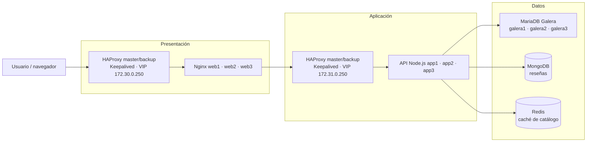

# Sistema distribuido de tres capas

Proyecto académico para la materia **Sistemas Distribuidos**. El equipo diseñó
una tienda web distribuida con balanceo en las capas de presentación y
aplicación, almacenamiento relacional y NoSQL, y una caché para el catálogo.

**Integrantes:** Javier Rodriguez Rodriguez y Adriana Dzib De la Rosa

**Docente:** Ismael Jiménez Sánchez

**Tarea:** #995

## Arquitectura

La infraestructura se ejecuta con Docker Compose en un solo host. Incluye dos
pares HAProxy master/backup con Keepalived, tres nodos web Nginx, tres nodos API
Node.js, tres nodos MariaDB Galera, una instancia MongoDB y una instancia
Redis.

### Diagrama JPG

**Pendiente del equipo:** insertar aquí la imagen JPG exportada desde Lucidchart
(por ejemplo, `docs/arquitectura.jpg`). El diagrama Mermaid siguiente sirve
como referencia mientras se agrega el archivo final.

<!-- INSERTAR:  -->



### Responsabilidad de las capas

- **Presentación:** HAProxy distribuye las solicitudes entre `web1`, `web2` y
  `web3`. Keepalived administra una VIP entre los HAProxy.
- **Aplicación:** HAProxy distribuye las solicitudes entre `app1`, `app2` y
  `app3`. La API ofrece catálogo, reseñas y estado de salud.
- **Datos:** MariaDB Galera almacena el catálogo; MongoDB almacena las reseñas;
  Redis conserva durante 60 segundos la respuesta de productos más baratos.

### Alcance actual

Los tres nodos Galera están configurados como clúster, pero la API y el
inicializador se conectan directamente a `galera1`. La aplicación no balancea
consultas entre nodos ni cambia automáticamente a `galera2` o `galera3` si
`galera1` falla. MongoDB y Redis son instancias únicas. Además, todo Compose se
ejecuta en un solo host; esta demostración no ofrece alta disponibilidad ante
la caída de ese host.

El puerto 80 del host está publicado en el contenedor
`presentation-lb-master`. La VIP de presentación no traslada la publicación de
puerto de Docker al contenedor backup. El failover de la VIP puede probarse
desde la red Docker, pero no equivale a failover del acceso `localhost:80`.

## Requisitos

- Windows 10/11 con Docker Desktop iniciado y el motor de contenedores Linux.
- Docker Compose v2 (`docker compose`).
- PowerShell.
- Puertos locales 80 y 8088 disponibles.
- Para la PoC de carga: ApacheBench (`ab`) instalado, o JMeter.

## Ejecución en Windows

Abre PowerShell en la carpeta raíz del repositorio. El archivo `.env` contiene
configuración local y está excluido de Git para evitar publicar contraseñas. Si
no existe (por ejemplo, después de clonar el repositorio), créalo y agrega las
variables requeridas:

```powershell
notepad .env
```

Contenido inicial de `.env`:

```dotenv
MARIADB_ROOT_PASSWORD=change-this-root-password
MARIADB_BACKUP_PASSWORD=change-this-backup-password
CATALOG_DB_NAME=store
CATALOG_DB_USER=store_app
CATALOG_DB_PASSWORD=change-this-catalog-password
MONGO_DB_NAME=store_reviews
MONGO_ROOT_USERNAME=store_admin
MONGO_ROOT_PASSWORD=change-this-mongodb-password
NAGIOSADMIN_PASSWORD=change-this-nagios-password
```

Reemplaza todas las contraseñas de ejemplo por valores propios. No publiques
`.env` ni uses estas credenciales de demostración en un servidor compartido.
Después, construye e inicia todos los servicios:

```powershell
docker compose up --build -d
docker compose ps
```

La primera ejecución puede tardar mientras Docker descarga imágenes y Galera
se inicializa. Confirma que los servicios estén iniciados y revisa los logs si
alguno falla:

```powershell
docker compose logs --tail 100 catalog-init app1 app2 app3 galera1 galera2 galera3
```

Direcciones locales:

- Tienda: <http://localhost/>
- API de salud: <http://localhost/api/health>
- Productos más baratos: <http://localhost/api/products/cheapest>
- Reseñas de `ST-001`: <http://localhost/api/products/ST-001/reviews>
- Nagios: <http://localhost:8088/> (usuario `nagiosadmin`; contraseña de `.env`)

La tienda muestra la ruta de las solicitudes. El encabezado `X-Request-Trace`
identifica los balanceadores, nodos y almacenes involucrados. El endpoint
`POST /api/cache/clear` elimina la entrada de caché del catálogo.

Para detener los contenedores sin borrar los datos persistidos:

```powershell
docker compose down
```

Para borrar también los volúmenes de MariaDB y MongoDB y reiniciar los datos
desde cero, usa `docker compose down -v`. Esta operación es destructiva.

## PoC 1: Prueba de carga

**Objetivo:** medir la respuesta del endpoint de catálogo bajo concurrencia y
comprobar que la API continúa respondiendo. Ejecútala con el sistema levantado
y comienza con una carga moderada.

Con ApacheBench (`ab`) disponible en `PATH`:

```powershell
ab -n 500 -c 20 http://localhost/api/products/cheapest
```

`-n` indica el total de solicitudes y `-c` la concurrencia. Para medir una
petición de caché fría, elimina la entrada primero y ejecuta una sola vez con
`-c 1`; para medir caché caliente, repite la prueba normal:

```powershell
Invoke-RestMethod -Method Post -Uri http://localhost/api/cache/clear
ab -n 1 -c 1 http://localhost/api/products/cheapest
ab -n 500 -c 20 http://localhost/api/products/cheapest
```

Si no tienes `ab`, crea un plan en JMeter con un grupo de hilos, el endpoint
`GET /api/products/cheapest`, una carga inicial de 20 usuarios y 500 iteraciones,
y un listener de resumen. No aumentes la carga sin vigilar CPU, memoria y logs.

**Registrar en el informe:** herramienta y versión, fecha, concurrencia,
solicitudes completadas, solicitudes fallidas, tiempo medio, percentiles y
solicitudes por segundo. No se incluyen resultados hasta que el equipo ejecute
la prueba en su entorno.

**Espacio para resultados:**

> Pendiente: agregar tabla, captura de ApacheBench/JMeter y análisis de los
> resultados obtenidos por el equipo.

## PoC 2: Failover simple

**Objetivo:** comprobar que el HAProxy de aplicación deja de enviar tráfico a
un nodo API detenido y continúa usando las réplicas disponibles.

1. Confirma que el endpoint responde antes de la prueba:

   ```powershell
   curl.exe -i http://localhost/api/health
   ```

2. Detén temporalmente un nodo API:

   ```powershell
   docker compose stop app1
   ```

3. Espera unos segundos a que HAProxy detecte el nodo inactivo y consulta de
   nuevo el endpoint. La respuesta debe ser `200`; el encabezado
   `X-Request-Trace` debe mostrar `app2` o `app3` como nodo de aplicación:

   ```powershell
   curl.exe -i http://localhost/api/health
   ```

4. Recupera el servicio y confirma que volvió a responder:

   ```powershell
   docker compose start app1
   curl.exe -i http://localhost/api/health
   ```

**Criterio de éxito:** las solicitudes siguen recibiendo HTTP 200 durante la
caída de `app1`, atendidas por los nodos API restantes, y el servicio detenido
se puede iniciar de nuevo. Guarda los encabezados y las horas de cada paso.

Esta PoC prueba la tolerancia a la caída de una réplica API, no la alta
disponibilidad del host ni el failover del puerto 80 publicado por Docker.

## PoC 3: Chaos Engineering con Chaos Monkey

**Objetivo:** inyectar una falla controlada en una réplica API, comprobar la
hipótesis de que el servicio mantiene disponibilidad con las otras réplicas y
restaurar el nodo al terminar.

**Compatibilidad:** Netflix Chaos Monkey está pensado para entornos gestionados
por Spinnaker y grupos de instancias en la nube; no está integrado ni se puede
ejecutar directamente sobre este proyecto Docker Compose. No se debe reportar
la prueba siguiente como una ejecución de Netflix Chaos Monkey. Es un
experimento local de inyección de fallas inspirado en Chaos Monkey, usando
Docker Compose.

Ejecuta este bloque en PowerShell desde la raíz del repositorio. Selecciona al
azar una réplica API, la detiene, prueba diez veces la ruta de salud y siempre
intenta iniciarla de nuevo:

```powershell
$target = Get-Random -InputObject @("app1", "app2", "app3")
Write-Host "Nodo seleccionado: $target"
docker compose stop $target
try {
    for ($i = 1; $i -le 10; $i++) {
        curl.exe --fail --silent --show-error http://localhost/api/health | Out-Null
        if ($LASTEXITCODE -ne 0) {
            throw "La solicitud $i falló durante el experimento."
        }
        Write-Host "Solicitud $i: OK"
    }
}
finally {
    docker compose start $target
}
```

**Límites y seguridad:** realiza esta prueba solo en el entorno local, nunca en
una instalación compartida o productiva. No detengas Galera, MongoDB, Redis ni
los balanceadores en este experimento inicial. Si una solicitud falla,
registra el resultado y verifica la recuperación con
`docker compose ps` y `curl.exe -i http://localhost/api/health`.

**Espacio para resultados:**

> Pendiente: documentar hipótesis, nodo afectado, duración, errores observados,
> evidencia de recuperación y conclusiones del equipo. Para usar Netflix Chaos
> Monkey real, se requiere migrar/desplegar la infraestructura en una plataforma
> compatible con Spinnaker y documentar esa configuración por separado.

## Documentación y evidencias

Este README y los archivos Markdown del repositorio constituyen la
documentación del proyecto. El equipo debe completar los espacios pendientes
con el diagrama JPG exportado y las evidencias reales de las PoC antes de
presentar resultados como ejecutados.