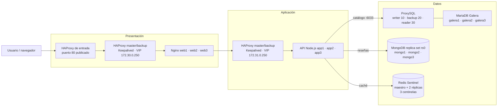

# Sistema distribuido de tres capas

Tienda web distribuida desarrollada para la materia **Sistemas Distribuidos**
(Tarea #995). La solución separa presentación, aplicación y datos, y combina
balanceo con alta disponibilidad, bases replicadas, caché y monitoreo.

**Autores:** Javier Rodriguez Rodriguez y Adriana Dzib De la Rosa  
**Docente:** Ismael Jiménez Sánchez

Javier y Adriana desarrollamos y verificamos el sistema en equipo siguiendo
las indicaciones del docente. Este README presenta la arquitectura, el uso del
stack y el mapa de pruebas; los procedimientos detallados y la evidencia se
mantienen en los documentos enlazados.

## Documentación

| Documento | Contenido |
|---|---|
| [Plan de pruebas](resilience-lab/TEST-PLAN.md) | Casos funcionales, rendimiento, disponibilidad, caos y observabilidad; herramientas y criterios esperados. |
| [Resultados de pruebas](resilience-lab/RESULTADOS-PRUEBAS.md) | Mediciones realizadas, estado de cada área, límites de alcance y evidencia visual. |
| [Guía del laboratorio](resilience-lab/README.md) | Inicio del dashboard, uso de ApacheBench, Siege, JMeter y Chaos Monkey. |
| [Guía de las tres PoC LAN](PoCs/README.md) | Pasos para ejecutar carga, failover por capas y caos con un host y un cliente. |

## Arquitectura

El stack se ejecuta con Docker Compose en un host. Los pares HAProxy y
Keepalived administran las VIP de presentación y aplicación. La capa de datos
combina MariaDB Galera y ProxySQL para el catálogo, MongoDB Replica Set para
reseñas y Redis Sentinel para la caché descartable.



### Responsabilidades y comportamiento

- **Presentación:** HAProxy distribuye tráfico entre `web1`, `web2` y `web3`;
  Keepalived administra la VIP `172.30.0.250`.
- **Aplicación:** HAProxy distribuye solicitudes entre `app1`, `app2` y `app3`
  mediante la VIP `172.31.0.250`. La API expone catálogo, reseñas y salud.
- **Catálogo:** la API se conecta a ProxySQL (`proxysql:6033`), que enruta
  escrituras a un nodo Galera writer y lecturas a los nodos disponibles.
- **Reseñas:** MongoDB `rs0` elige automáticamente un primario entre sus tres
  miembros.
- **Caché:** Redis Sentinel vigila un maestro y dos réplicas. Si Redis no está
  disponible, el catálogo se consulta en MariaDB; la caché puede reconstruirse.
- **Monitoreo:** Nagios comprueba servicios y endpoints. Las API mantienen
  direcciones fijas `172.31.0.21`–`172.31.0.23` para que una réplica caída
  pueda generar una alerta concreta aunque Docker retire su registro DNS.

| Endpoint o ajuste | Función |
|---|---|
| `http://localhost/` | Tienda web publicada en el puerto 80. |
| `http://localhost/api/health` | Estado de API, MariaDB, MongoDB y Redis. |
| `http://localhost/api/products/cheapest` | Catálogo utilizado en las pruebas de lectura y caché. |
| `http://localhost:8090` | Dashboard local de pruebas; se inicia junto con el laboratorio. |
| `proxysql:6033` / `proxysql:6032` | Puerto de datos de la API / administración interna de ProxySQL. |
| `DB_POOL_SIZE` | Máximo de conexiones de MariaDB por réplica de API. |
| `CATALOG_CACHE_TTL_SECONDS` | Tiempo de vida de la caché del catálogo (60 s por defecto). |
| `REDIS_COMMAND_TIMEOUT_MS` | Límite de espera para comandos Redis (2000 ms por defecto). |

Este diseño tolera fallas de réplicas y procesos dentro del mismo host; no
elimina el punto único de falla del host, Docker Desktop ni del proxy de
entrada. El detalle de la configuración de datos está en
[docker-compose.yml](docker-compose.yml) y en sus directorios de servicio.

## Estructura del repositorio

| Ruta | Propósito |
|---|---|
| `docker-compose.yml` | Servicios, redes, volúmenes, healthchecks y políticas de reinicio del stack principal. |
| `application/`, `web/` | API Node.js y nodos web Nginx. |
| `haproxy/`, `keepalived/` | Balanceo, comprobaciones y failover de las VIP. |
| `galera/`, `proxysql/`, `mongo/`, `redis/`, `database/` | Motores de datos, proxy e inicialización del catálogo. |
| `nagios/` | Definiciones de hosts, servicios y alertas locales. |
| `PoCs/` | Tres pruebas guiadas LAN y scripts de readiness, carga, failover y monitoreo. |
| `resilience-lab/` | ApacheBench, Siege, JMeter, Chaos Monkey, dashboard y volumen de resultados. |
| `Start-Stack.ps1`, `Stop-Stack.ps1` | Arranque y apagado ordenado del stack. |
| `Install-AutoStart.ps1` | Instalación o retirada del arranque automático al iniciar sesión. |

## Inicio en Windows

**Requisitos:** Windows 10/11, Docker Desktop con Compose v2 y PowerShell.
Desde PowerShell, en la raíz del repositorio:

```powershell
docker compose --env-file .\.env.exam up -d --build
docker compose --env-file .\.env.exam ps
powershell -NoProfile -ExecutionPolicy Bypass -File .\PoCs\Test-StackHealth.ps1
```

La comprobación de salud debe concluir con **9/9 verificaciones**. La tienda se
publica en `http://localhost/` y la API en
`http://localhost/api/health`. La respuesta esperada es HTTP 200 con
`"status":"ok"` y las dependencias disponibles.

El archivo de entorno de demostración se pasa explícitamente a Compose para
configurar los servicios. No publiques credenciales reales ni las pegues en
capturas o resultados.

Para acceder desde una segunda laptop, obtén la IPv4 LAN del host con
`ipconfig | findstr /i "IPv4"` y usa `http://<IP_HOST>/`. Verifica primero
`Test-NetConnection <IP_HOST> -Port 80`; la guía de PoCs describe la regla de
firewall restringida si Windows bloquea la conexión.

### Iniciar el laboratorio

Con el stack principal en ejecución, inicia las herramientas y el dashboard:

```powershell
docker compose -f .\resilience-lab\docker-compose.yml up -d --build
Start-Process http://localhost:8090
```

El laboratorio se conecta a la red `distributed-three-tier_edge`; conserva el
nombre del proyecto Compose principal o configura `TARGET_PROJECT` de forma
coherente. El dashboard permite definir el destino y parámetros de las pruebas,
consultar el historial y abrir el informe HTML de JMeter. Consulta la
[guía del laboratorio](resilience-lab/README.md) antes de iniciar una prueba
que detenga contenedores.


## Mapa de pruebas

El [plan de pruebas](resilience-lab/TEST-PLAN.md) organiza la verificación en
cinco áreas. El [informe](resilience-lab/RESULTADOS-PRUEBAS.md) distingue lo
medido de los escenarios que no se ejecutaron; el plan define cobertura y no
debe interpretarse por sí solo como evidencia.

| Área | Qué verificamos | Herramientas y evidencia |
|---|---|---|
| 1. Línea base y funcionalidad | Salud de API y dependencias, ruta de catálogo, trazas, balanceo, consistencia Galera, réplica MongoDB y degradación Redis. | `Test-StackHealth.ps1`, pruebas unitarias y comprobaciones del plan. |
| 2. Rendimiento | Humo, carga, efecto de caché, tasa de errores, latencias y prueba sostenida; se documentan aparte los picos o duraciones no cubiertos. | `Invoke-LoadTest.ps1`, ApacheBench, Siege y JMeter. |
| 3. Alta disponibilidad y failover | Réplicas web/API, VIP y procesos HAProxy, Galera/ProxySQL, MongoDB, Redis/Sentinel y restauración tras la falla. | `Test-LanFailover.ps1`, `Invoke-ChaosTest.ps1` y escenarios controlados del informe. |
| 4. Ingeniería del caos | Simulación y fallas controladas de contenedores; el laboratorio permite grupos de balanceo, aplicación, datos y dependencias. | Chaos Monkey, Siege/JMeter y monitoreo de disponibilidad. |
| 5. Observabilidad y alertas | Estado y tiempos de respuesta, eventos locales Nagios y validez de su configuración. | Nagios, logs, `/api/health`, `X-Request-Trace` e informe de resultados. |

Algunos casos del plan tienen impacto importante —por ejemplo, carga de cientos
de usuarios, pérdida total de una capa o cambios de red— y no se ejecutan
automáticamente. Evalúa el alcance, acuerda límites y comprueba la restauración
antes de cada experimento. No se debe inferir que un caso pasó solo porque la
herramienta lo permita.

## Las tres PoC LAN

La carpeta `PoCs/` se conserva porque contiene los scripts ejecutables y las
instrucciones para demostrar el comportamiento desde una segunda laptop. En
cada escenario, el **host** controla Docker y restaura las fallas; el
**cliente** genera tráfico HTTP y registra la respuesta y `X-Request-Trace`.
Los pasos y comandos completos están en la
[guía de PoCs](PoCs/README.md).

1. **Carga:** mide caché fría y caliente, solicitudes por segundo, latencias y
   errores desde el cliente.
2. **Failover por capas:** comprueba una réplica API y el failover de los
   balanceadores de presentación y aplicación.
3. **Caos controlado:** detiene una réplica API durante un intervalo limitado,
   monitorea la disponibilidad y confirma su recuperación.

Las pruebas adicionales del plan —incluidas las herramientas del dashboard,
casos de datos y monitoreo— se explican en la
[guía del laboratorio](resilience-lab/README.md) y se reportan en
[RESULTADOS-PRUEBAS.md](resilience-lab/RESULTADOS-PRUEBAS.md). No se duplican
como PoC independientes porque pertenecen a los escenarios del laboratorio.

## Validación rápida y recuperación

Pruebas reproducibles desde la raíz:

```powershell
npm --prefix .\application test
docker compose --env-file .\.env.exam config --quiet
docker compose -f .\resilience-lab\docker-compose.yml config --quiet
powershell -NoProfile -ExecutionPolicy Bypass -File .\PoCs\Test-StackHealth.ps1
```

Para apagar los servicios sin borrar datos:

```powershell
powershell -NoProfile -ExecutionPolicy Bypass -File .\Stop-Stack.ps1
```

Para iniciarlos de nuevo:

```powershell
powershell -NoProfile -ExecutionPolicy Bypass -File .\Start-Stack.ps1
```

`docker compose stop` conserva contenedores y volúmenes. `docker compose down`
elimina los contenedores; `docker compose down -v` elimina también los
volúmenes persistentes y no se debe usar si se quieren conservar los datos.
Después de un reinicio, comprueba el estado con `Test-StackHealth.ps1` antes de
comenzar una PoC. Si Galera no recupera el quórum, evita un bootstrap manual
sin revisar primero la posición de recuperación y respaldar los datos.

## Resultados y evidencia

La última validación documentada incluye **9/9 comprobaciones de readiness**,
**29/29 servicios principales activos**, **11/11 pruebas unitarias aprobadas**,
configuraciones Compose válidas y preflight de Nagios sin advertencias ni
errores. El informe enlazado especifica métricas, resultados por escenario,
límites y capturas. Los números corresponden a una ejecución local y no son
garantías de capacidad ni objetivos SLO.

---

**Proyecto realizado por Javier Rodriguez Rodriguez y Adriana Dzib De la Rosa**
para la materia **Sistemas Distribuidos**, bajo las indicaciones del docente
**Ismael Jiménez Sánchez**.
