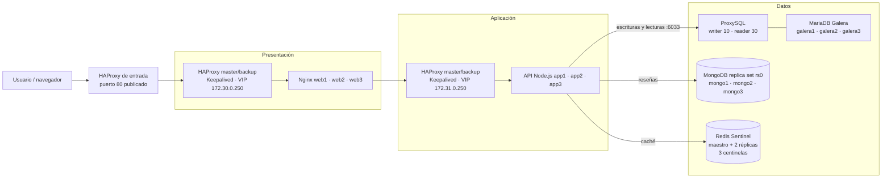

# Sistema distribuido de tres capas

Proyecto académico para la materia **Sistemas Distribuidos**. El equipo diseñó
una tienda web distribuida con balanceo en las capas de presentación y
aplicación, almacenamiento relacional y NoSQL, y una caché para el catálogo.

**Integrantes:** Javier Rodriguez Rodriguez y Adriana Dzib De la Rosa

**Docente:** Ismael Jiménez Sánchez

**Tarea:** #995

## Arquitectura

La infraestructura se ejecuta con Docker Compose en un solo host. Incluye dos
pares HAProxy master/backup con Keepalived, tres nodos web Nginx, tres nodos API
Node.js, tres nodos MariaDB Galera detrás de ProxySQL, un replica set MongoDB de
tres nodos y Redis con un maestro, dos réplicas y tres centinelas.

### Diagrama JPG

**Pendiente del equipo:** insertar aquí la imagen JPG exportada desde Lucidchart
(por ejemplo, `docs/arquitectura.jpg`). El diagrama Mermaid siguiente sirve
como referencia mientras se agrega el archivo final.

<!-- INSERTAR:  -->



### Responsabilidad de las capas

- **Presentación:** HAProxy distribuye las solicitudes entre `web1`, `web2` y
  `web3`. Keepalived administra una VIP entre los HAProxy.
- **Aplicación:** HAProxy distribuye las solicitudes entre `app1`, `app2` y
  `app3`. La API ofrece catálogo, reseñas y estado de salud.
- **Datos:** MariaDB Galera almacena el catálogo y ProxySQL enruta las
  escrituras al nodo writer y las lecturas a los nodos reader. MongoDB replica
  set almacena las reseñas. Redis conserva la respuesta de productos más baratos
  durante el TTL configurado en `CATALOG_CACHE_TTL_SECONDS` (60 segundos por
  defecto); si Redis no está disponible, el catálogo se sirve desde MariaDB.

### Alcance y límites

La API ya no se conecta a `galera1`: usa `DB_HOST=proxysql`, por lo que
ProxySQL decide qué nodo Galera atiende cada consulta y promueve otro writer si
el actual falla. MongoDB dejó de ser una instancia única: `rs0` mantiene tres
nodos con un primario elegido automáticamente. Redis tiene un maestro, dos
réplicas y tres centinelas; la caché sigue siendo descartable y el catálogo
puede servirse desde MariaDB.

Todo Compose se ejecuta en un solo host. Esta demostración **no** ofrece alta
disponibilidad ante la caída del host, de Docker Desktop, de
`presentation-entry` ni de la red local. El objetivo es tolerar la caída de
réplicas y procesos dentro del mismo host, no sustituir una plataforma
multinodo.

### Capa de datos y alta disponibilidad

#### ProxySQL para MariaDB

La API y `catalog-init` se conectan a `proxysql:6033`. ProxySQL monitorea el
estado `wsrep` de los tres nodos y los clasifica en grupos:

| Grupo | Uso | Contenido |
|---|---|---|
| `10` | Writer | Un solo nodo `Synced` y `Primary` |
| `20` | Backup writer | Candidatos a writer |
| `30` | Reader | Nodos sincronizados para lecturas |
| `40` | Offline | Nodos no disponibles |

Las reglas de consulta envían `SELECT ... FOR UPDATE` y las escrituras al grupo
`10`, y los `SELECT` simples al grupo `30`. Si el writer falla, ProxySQL
promueve otro nodo sin cambiar la configuración de la API. El usuario
`proxysql_monitor` se crea durante el bootstrap con permisos mínimos (`USAGE`,
`PROCESS`, `REPLICATION CLIENT`) y no se usa para las consultas de la tienda.

El panel de administración de ProxySQL escucha solo en la red interna, en
`proxysql:6032`. Para consultarlo desde el host:

```powershell
docker exec -it distributed-three-tier-proxysql-1 `
  mysql -u admin -pchange-this-proxysql-admin-password -h 127.0.0.1 -P6032
```

#### MongoDB replica set

`rs0` tiene tres miembros: `mongo1` (prioridad 2), `mongo2` y `mongo3`
(prioridad 1). Los nodos comparten un keyfile para autenticación interna y
`catalog-init` crea el usuario de aplicación `store_app` limitado a
`store_reviews`. La API usa `MONGO_HOSTS=mongo1,mongo2,mongo3` y
`MONGO_REPLICA_SET=rs0`; el driver descubre al primario y tolera la caída de un
nodo. Si el primario se detiene, se elige otro y las reseñas siguen
respondiendo. La API no bloquea el arranque si el replica set todavía no tiene
primario: la conexión se intenta en segundo plano y, si el intento falla, el
cliente se reemplaza para que una petición posterior pueda reconectar cuando
MongoDB vuelva. `/api/health` marca `mongodb: unavailable` mientras tanto y las
reseñas responden `503`, sin afectar el catálogo.

#### Redis Sentinel y caché descartable

Redis tiene un maestro, dos réplicas y tres centinelas con quórum 2. La API se
conecta a `redis-sentinel1/2/3:26379` y descubre al maestro con el nombre
`mymaster`; si el maestro cae, Sentinel promueve una réplica. Redis no usa AOF
ni RDB: es una caché descartable y el catálogo se reconstruye desde MariaDB.
Los centinelas monitorean la IP fija `172.32.0.11` en lugar del nombre
`redis-master`, porque Docker elimina el DNS de un contenedor detenido y
Sentinel entra en `TILT` cuando no puede resolver el nombre, lo que bloquea el
failover.

La API aplica `REDIS_COMMAND_TIMEOUT_MS` (2 segundos por defecto) a cada comando
de caché. Si Redis no responde, el catálogo se lee de MariaDB en lugar de
quedarse esperando. `POST /api/cache/clear` sigue devolviendo `503` cuando Redis
no está disponible: la lectura degrada, pero la administración explícita de la
caché requiere Redis.

#### Dimensionamiento del pool de conexiones

`DB_POOL_SIZE` es el límite de conexiones **por réplica de API**. Con tres
réplicas, el máximo simultáneo es `3 × DB_POOL_SIZE` conexiones de aplicación,
además de las conexiones de monitoreo de ProxySQL. Los valores del proyecto
mantienen ese total por debajo de los límites de ProxySQL y MariaDB:

| Variable | Valor por defecto | Efecto |
|---|---|---|
| `DB_POOL_SIZE` | 10 | Conexiones por réplica de API |
| `DB_POOL_IDLE_TIMEOUT_MS` | 60000 | Cierre de conexiones inactivas |
| `DB_CONNECT_TIMEOUT_MS` | 5000 | Límite para abrir una conexión |
| `REDIS_COMMAND_TIMEOUT_MS` | 2000 | Límite por comando de caché |
| `CATALOG_CACHE_TTL_SECONDS` | 60 | TTL del catálogo |

ProxySQL limita el usuario de aplicación a `max_connections=200` y cada servidor
Galera a `max_connections=30`. Al escalar réplicas de API hay que comprobar que
`N × DB_POOL_SIZE` siga por debajo de esos límites y de `max_connections` de
MariaDB; si se aumenta el pool, hay que subir también los límites de ProxySQL y
Galera de forma coordinada.

### Acceso desde el segundo equipo

El equipo que ejecuta Docker Compose es el **host del servicio**; las otras
computadoras de la misma red local actúan como **clientes de prueba**. El puerto
80 publicado por Docker se consume usando la dirección IPv4 LAN del host, por
ejemplo `http://192.168.1.50/`, no usando `localhost`: en el segundo equipo,
`localhost` se refiere a ese propio equipo.

1. Conecta ambos equipos a la misma red local y levanta el proyecto en el host:

    ```powershell
    docker compose --env-file .env.exam up --build -d
    ```

2. En el host, consulta su dirección IPv4 con `ipconfig`. Usa la dirección de
    la interfaz conectada a la misma red que el equipo cliente (por ejemplo,
    `192.168.1.50`; no uses `127.0.0.1`). Para filtrar las direcciones IPv4:

    ```powershell
    ipconfig | findstr /i "IPv4"
    ```

3. Desde el segundo equipo, comprueba que el puerto web del host es alcanzable,
    sustituyendo la IP de ejemplo:

    ```powershell
    Test-NetConnection 192.168.1.50 -Port 80
    ```

    Si `TcpTestSucceeded` es `False`, comprueba que Docker sigue activo, que
    ambos equipos están en la misma LAN y revisa el perfil de la interfaz con
    `Get-NetConnectionProfile`. En una LAN privada de confianza, si hace falta,
    un administrador puede permitir TCP/80 solo entre las IP del host y del
    cliente por la interfaz conectada. Cambia las direcciones y el nombre de
    interfaz del ejemplo; no cambies el perfil de red solo para la PoC:

    ```powershell
    $hostIp = "192.168.1.50"
    $clienteIp = "192.168.1.25"
    $interfaz = "Wi-Fi"
    $perfil = (Get-NetConnectionProfile -InterfaceAlias $interfaz).NetworkCategory
    New-NetFirewallRule -DisplayName "Distributed Store HTTP test" -Direction Inbound -Protocol TCP -LocalPort 80 -LocalAddress $hostIp -RemoteAddress $clienteIp -InterfaceAlias $interfaz -Action Allow -Profile $perfil
    ```

    No abras TCP/80 a toda una red pública ni cambies el perfil de una Wi-Fi
    pública solo para ejecutar la PoC. Si la interfaz aparece como `Public`,
    usa esta regla únicamente en una LAN privada de confianza y mantenla
    restringida a la IP del cliente.

4. Abre en el navegador del segundo equipo `http://192.168.1.50/`, usando la
    IP real del host. La API también se puede verificar desde ese equipo en
    `http://192.168.1.50/api/health`.

Conviene reservar la IP del host en el router o verificarla antes de cada
sesión. El proyecto y Docker Compose se ejecutan en un solo host; el equipo
cliente no necesita iniciar otra copia del stack. Las pruebas que detienen o
inician contenedores se ejecutan en el host, mientras la carga y las
comprobaciones HTTP se hacen desde el cliente. Nagios está publicado únicamente
en `127.0.0.1:8088` y no es accesible desde la LAN.

La PoC LAN realizada el 22-10-2026, con resultados, scripts reutilizables de
monitorización/failover y gestión restringida de firewall, está en
[poc/2026-10-22-lan-failover](./poc/2026-10-22-lan-failover/README.md). Sus
resultados corresponden a esa ejecución; repite las comprobaciones antes de
asumir que las IP o el perfil de red siguen iguales.

El puerto 80 está publicado en `presentation-entry`, que reenvía las solicitudes
a la VIP Docker `172.30.0.250`. Keepalived mueve esa VIP entre
`presentation-lb-master` y `presentation-lb-backup`, por lo que el acceso desde
la IP LAN puede probar el failover de esos balanceadores. La VIP no se publica
directamente en la LAN. `presentation-entry` y el host Docker siguen siendo
puntos únicos de falla; esta configuración no ofrece alta disponibilidad ante
la caída del host.

Para probar la conmutación sin reemplazar el namespace de red, pausa y reanuda
el HAProxy desde otra terminal mientras se hacen solicitudes:

```powershell
docker compose --env-file .env.exam pause presentation-lb-master
docker compose --env-file .env.exam unpause presentation-lb-master
```

El chequeo de Keepalived exige ahora una respuesta HTTP 200, de modo que
también detecta un HAProxy pausado o que no responde a HTTP. Si se usa
`docker compose stop` y luego `start` sobre un HAProxy, Docker puede recrear su
namespace de red; en ese caso reinicia también su sidecar Keepalived para que
se asocie al namespace activo:

```powershell
docker compose --env-file .env.exam start presentation-lb-master
docker compose --env-file .env.exam restart presentation-keepalived-master
```

Para la capa de aplicación, sustituye `presentation-lb-master` y
`presentation-keepalived-master` por `application-lb-master` y
`application-keepalived-master`.

## Requisitos

- Windows 10/11 con Docker Desktop iniciado y el motor de contenedores Linux.
- Docker Compose v2 (`docker compose`).
- PowerShell.
- Puertos locales 80 y 8088 disponibles.
- Para la PoC de carga: ApacheBench (`ab`) instalado, o JMeter.

## Ejecución en Windows

Abre PowerShell en la carpeta raíz del repositorio. El archivo `.env.exam`
incluido en el proyecto contiene valores de demostración para el entorno local.
No agregues contraseñas reales a ese archivo ni las publiques. Para usar
credenciales propias, crea un archivo local ignorado por Git (por ejemplo,
`.env.local`) y reemplaza `.env.exam` por `.env.local` en los comandos
`docker compose --env-file`:

```powershell
notepad .env.local
```

Contenido inicial de `.env.local`:

```dotenv
MARIADB_ROOT_PASSWORD=change-this-root-password
MARIADB_BACKUP_PASSWORD=change-this-backup-password
CATALOG_DB_NAME=store
CATALOG_DB_USER=store_app
CATALOG_DB_PASSWORD=change-this-catalog-password
MONGO_DB_NAME=store_reviews
MONGO_ROOT_USERNAME=store_admin
MONGO_ROOT_PASSWORD=change-this-mongodb-password
MONGO_APP_USERNAME=store_app
MONGO_APP_PASSWORD=change-this-mongodb-app-password
CATALOG_CACHE_TTL_SECONDS=60
REDIS_COMMAND_TIMEOUT_MS=2000
PROXYSQL_ADMIN_PASSWORD=change-this-proxysql-admin-password
PROXYSQL_MONITOR_USER=proxysql_monitor
PROXYSQL_MONITOR_PASSWORD=change-this-proxysql-monitor-password
DB_POOL_SIZE=10
NAGIOSADMIN_PASSWORD=change-this-nagios-password
```

Reemplaza todas las contraseñas de ejemplo por valores propios. No publiques
`.env.local` ni uses las credenciales de demostración de `.env.exam` en un
servidor compartido. Para iniciar el entorno incluido en el proyecto, construye
y levanta todos los servicios:

```powershell
docker compose --env-file .env.exam up --build -d
docker compose --env-file .env.exam ps
```

La primera ejecución puede tardar mientras Docker descarga imágenes y Galera
se inicializa. Confirma que los servicios estén iniciados y revisa los logs si
alguno falla:

```powershell
docker compose --env-file .env.exam logs --tail 100 catalog-init db-bootstrap mongo-init proxysql app1 app2 app3 galera1 galera2 galera3 mongo1 mongo2 mongo3 redis-master redis-sentinel1
```

`galera1` usa `galera/entrypoint.sh` para decidir si arranca el clúster o se
une a uno existente. Si hay datos y `safe_to_bootstrap=0` (por ejemplo, porque
solo se detuvo `galera1` mientras `galera2` y `galera3` seguían activos), el
nodo se une al clúster en lugar de negarse a arrancar. Solo hace bootstrap
cuando no hay datos o cuando el nodo fue el último en salir del componente
primario.

Si todos los nodos están detenidos y ninguno tiene `safe_to_bootstrap=1`,
`mysqld` se niega a hacer bootstrap para no perder transacciones. En ese caso no
borres los volúmenes ni fuerces el bootstrap: respalda los tres volúmenes y
recupera la posición con `wsrep-recover` en cada nodo; solo debe iniciar el nodo
con la secuencia recuperada más alta. Después inicia los pares y confirma que
los tres nodos estén saludables y sincronizados. Si las posiciones difieren o
no puedes determinar el nodo más avanzado, detén la recuperación y conserva los
respaldos.

Keepalived corre en sidecars que comparten el namespace de red de cada HAProxy.
Después de reconstruirlos o iniciarlos, confirma que los cuatro sidecars sigan
activos en `docker compose ps`; un ciclo de reinicios indica que la VIP no está
lista para las PoC.

Direcciones desde el host Docker:

- Tienda: <http://localhost/>
- API de salud: <http://localhost/api/health>
- Productos más baratos: <http://localhost/api/products/cheapest>
- Reseñas de `ST-001`: <http://localhost/api/products/ST-001/reviews>
- Nagios: <http://localhost:8088/> (usuario `nagiosadmin`; contraseña del archivo de entorno seleccionado)

Desde el otro equipo, sustituye `localhost` por la IP LAN del host, por
ejemplo `http://192.168.1.50/` y `http://192.168.1.50/api/health`.

La tienda muestra la ruta de las solicitudes. El encabezado `X-Request-Trace`
identifica los balanceadores, nodos y almacenes involucrados; `mariadb` indica
una consulta a través de ProxySQL y `redis (unavailable)` indica que el catálogo
se sirvió desde MariaDB porque la caché no respondió. El endpoint
`POST /api/cache/clear` elimina la entrada de caché del catálogo y devuelve
`503` si Redis no está disponible.

`GET /api/health` devuelve `200` con estado `ok` cuando MariaDB, MongoDB y Redis
responden. Si falla MongoDB o Redis, mantiene `200` y marca `degraded`, porque
las reseñas o la caché no bloquean el catálogo. Solo devuelve `503` cuando
MariaDB no responde, ya que en ese caso la API no puede atender el catálogo.

La API se conecta a MariaDB por `proxysql:6033`, no a un nodo Galera concreto.
Se conecta a MongoDB con un usuario limitado a lectura y escritura en la base
`store_reviews`; `catalog-init` usa la cuenta administrativa solo para crear o
actualizar ese usuario durante la inicialización. La duración de la caché del
catálogo se configura con `CATALOG_CACHE_TTL_SECONDS` (60 segundos por defecto).
Las peticiones simultáneas a una caché vacía comparten una sola carga desde
MariaDB.

Para detener los contenedores sin borrar los datos persistidos:

```powershell
docker compose --env-file .env.exam down
```

Para borrar también los volúmenes de MariaDB y MongoDB y reiniciar los datos
desde cero, usa `docker compose --env-file .env.exam down -v`. Esta operación es
destructiva. Redis no tiene volúmenes de persistencia: al recrear sus
contenedores la caché arranca vacía y se reconstruye desde MariaDB.

## PoC 1: Prueba de carga

**Objetivo:** medir la respuesta del endpoint de catálogo bajo concurrencia y
comprobar que la API continúa respondiendo. Ejecútala con el sistema levantado
y comienza con una carga moderada.

En el equipo cliente, define la dirección LAN del host Docker y ejecuta
ApacheBench (`ab`) desde allí. Sustituye la IP del ejemplo por la dirección
obtenida con `ipconfig` en el host:

```powershell
$baseUrl = "http://192.168.1.50"
ab -n 500 -c 20 "$baseUrl/api/products/cheapest"
```

`-n` indica el total de solicitudes y `-c` la concurrencia. Para medir una
petición de caché fría, elimina la entrada primero y ejecuta una sola vez con
`-c 1`; para medir caché caliente, repite la prueba normal:

```powershell
$baseUrl = "http://192.168.1.50"
Invoke-RestMethod -Method Post -Uri "$baseUrl/api/cache/clear"
ab -n 1 -c 1 "$baseUrl/api/products/cheapest"
ab -n 500 -c 20 "$baseUrl/api/products/cheapest"
```

Si no tienes `ab`, crea un plan en JMeter con un grupo de hilos, el endpoint
`GET /api/products/cheapest`, una carga inicial de 20 usuarios y 500 iteraciones,
y un listener de resumen. No aumentes la carga sin vigilar CPU, memoria y logs.

**Registrar en el informe:** herramienta y versión, fecha, concurrencia,
solicitudes completadas, solicitudes fallidas, tiempo medio, percentiles y
solicitudes por segundo.

### Resultados de la ejecución del 23-10-2026

| Escenario | Solicitudes | Fallidas | Req/s | Tiempo medio | Observaciones |
|---|---|---|---|---|---|
| Caché fría (`-n 1 -c 1`) | 1 | 0 | 107.60 | 9.294 ms | Primera carga desde MariaDB, escritura en caché. |
| Caché caliente (`-n 500 -c 20`) | 500 | 0 | 1447.22 | 13.820 ms | Cache hit en todas las solicitudes; sin errores. |

Herramienta: ApacheBench (httpd:alpine) desde un contenedor en la red `edge`,
endpoint `GET /api/products/cheapest`, host Docker en `presentation-entry`.

## PoC 2: Failover simple

**Objetivo:** comprobar que el HAProxy de aplicación deja de enviar tráfico a
un nodo API detenido y continúa usando las réplicas disponibles.

1. En el equipo cliente, define la dirección LAN del host y confirma que el
    endpoint responde:

   ```powershell
    $baseUrl = "http://192.168.1.50"
    curl.exe -i "$baseUrl/api/health"
   ```

2. En una terminal PowerShell del host Docker, detén temporalmente un nodo API:

   ```powershell
   docker compose --env-file .env.exam stop app1
   ```

3. Desde el equipo cliente, espera unos segundos a que HAProxy detecte el nodo
    inactivo y consulta de nuevo. La respuesta debe ser `200`; el encabezado
    `X-Request-Trace` debe mostrar `app2` o `app3` como nodo de aplicación:

   ```powershell
    curl.exe -i "$baseUrl/api/health"
   ```

4. En el host Docker, recupera el servicio. Confirma desde el cliente que volvió
    a responder:

   ```powershell
   docker compose --env-file .env.exam start app1
   ```

    ```powershell
    curl.exe -i "$baseUrl/api/health"
    ```

**Criterio de éxito:** las solicitudes siguen recibiendo HTTP 200 durante la
caída de `app1`, atendidas por los nodos API restantes, y el servicio detenido
se puede iniciar de nuevo. Guarda los encabezados y las horas de cada paso.

Esta PoC prueba la tolerancia a la caída de una réplica API, no la alta
disponibilidad del host ni el failover del puerto 80 publicado por Docker.

### Resultados de la ejecución del 23-10-2026

- Baseline: `HTTP 200`, traza `app2`.
- Con `app1` detenido: 3 solicitudes consecutivas respondieron `HTTP 200`,
  trazas `app3`, `app2` y `app3`; HAProxy retiró `app1` del balanceo.
- Tras recuperar `app1`: `HTTP 200`, traza `app1`.

## PoC 3: Failover de la capa de datos

**Objetivo:** comprobar que la API sigue atendiendo cuando falla el writer de
Galera, el primario de MongoDB o el maestro de Redis. Ejecuta cada prueba con el
stack levantado y restaura el servicio al final.

### Galera writer

1. Consulta el writer actual:

   ```powershell
   docker exec distributed-three-tier-proxysql-1 mysql -u admin -pchange-this-proxysql-admin-password -h 127.0.0.1 -P6032 -e "SELECT hostgroup, srv_host, status FROM stats_mysql_connection_pool WHERE hostgroup=10;"
   ```

2. Detén el writer (por ejemplo `galera3`), espera 10 segundos y comprueba que
   ProxySQL promueve otro nodo y que una escritura funciona:

   ```powershell
   docker compose --env-file .env.exam stop galera3
   Start-Sleep -Seconds 10
   docker exec distributed-three-tier-proxysql-1 mysql -u store_app -pchange-this-catalog-password -h 127.0.0.1 -P6033 -D store -e "CREATE TABLE IF NOT EXISTS failover_probe (id INT); INSERT INTO failover_probe VALUES (1); SELECT COUNT(*) FROM failover_probe; DROP TABLE failover_probe;"
   curl.exe -i http://localhost/api/health
   docker compose --env-file .env.exam start galera3
   ```

3. Espera a que `galera3` vuelva a `Synced` y confirma `wsrep_cluster_size=3`.

### MongoDB primary

1. Identifica el primario:

   ```powershell
   docker exec distributed-three-tier-mongo1-1 mongosh --quiet --username store_admin --password change-this-mongodb-password --authenticationDatabase admin --eval "rs.status().members.map(m => m.name + '=' + m.stateStr).join(',')"
   ```

2. Detén el primario, espera la elección y prueba lectura y escritura de
   reseñas:

   ```powershell
   docker compose --env-file .env.exam stop mongo1
   Start-Sleep -Seconds 18
   curl.exe -i http://localhost/api/products/ST-001/reviews
   $body = '{"reviewer":"failover-probe","rating":5,"comment":"mongo failover probe"}'
   Set-Content -Path "$env:TEMP\review.json" -Value $body -Encoding ascii
   curl.exe -i -X POST -H "Content-Type: application/json" --data-binary "@$env:TEMP\review.json" http://localhost/api/products/ST-001/reviews
   docker compose --env-file .env.exam start mongo1
   ```

3. Confirma que `rs0` tiene un primario y dos secundarios.

### Redis master

1. Consulta el maestro:

   ```powershell
   docker exec distributed-three-tier-redis-sentinel1-1 redis-cli -p 26379 sentinel get-master-addr-by-name mymaster
   ```

2. Detén el contenedor que actúa como maestro (puede ser `redis-master`,
   `redis-replica1` o `redis-replica2` según el último failover), espera 20
   segundos y comprueba la promoción y la degradación. Sustituye
   `redis-master` por el servicio que corresponda a la IP devuelta en el paso
   anterior:

   ```powershell
   docker compose --env-file .env.exam stop redis-master
   Start-Sleep -Seconds 20
   docker exec distributed-three-tier-redis-sentinel1-1 redis-cli -p 26379 sentinel get-master-addr-by-name mymaster
   curl.exe -i http://localhost/api/health
   curl.exe -i http://localhost/api/products/cheapest
   docker compose --env-file .env.exam start redis-master
   ```

3. La salud debe responder `200` con `redis: unavailable` mientras dure la
   caída y el catálogo debe mostrar `redis (unavailable) -> mariadb`. Al
   reiniciar, Redis debe volver como réplica del maestro promovido.

### Caída total de Redis

1. Detén todos los contenedores Redis:

   ```powershell
   docker compose --env-file .env.exam stop redis-master redis-replica1 redis-replica2 redis-sentinel1 redis-sentinel2 redis-sentinel3
   ```

2. Comprueba que `/api/health` responde `200 degraded` y que el catálogo
   responde `200`; `POST /api/cache/clear` debe devolver `503`.

3. Reinicia los seis contenedores y espera a que la salud vuelva a `ok`:

   ```powershell
   docker compose --env-file .env.exam start redis-master redis-replica1 redis-replica2 redis-sentinel1 redis-sentinel2 redis-sentinel3
   ```

### Resultados de la ejecución del 23-10-2026

| Falla | Resultado observado |
|---|---|
| Writer Galera `galera3` detenido | ProxySQL promovió `galera2`; la escritura de prueba insertó 1 fila y el catálogo siguió en 200. Al reiniciar, `galera3` recuperó el writer y el clúster quedó `size=3`, `Synced`, `Primary`. |
| Primario MongoDB `mongo1` detenido | `mongo2` fue elegido primario; `GET /api/products/ST-001/reviews` respondió 200 y `POST` respondió 201. Al reiniciar, `mongo1` volvió como primario. |
| Maestro Redis `redis-replica1` detenido | Sentinel promovió `172.32.0.11`; `/api/health` respondió 200 y el catálogo 200 con traza `redis (unavailable) -> mariadb`; `POST /api/cache/clear` respondió 503. |
| Todos los Redis detenidos | `/api/health` respondió 200 `degraded` (`redis: unavailable`); el catálogo respondió 200 desde MariaDB. Tras reiniciar, la salud volvió a `ok` y el catálogo registró `cache miss` y escritura en caché. |
| `app1` detenido | HAProxy retiró el nodo; `/api/health` siguió en 200 por `app2`/`app3` (PoC 2). |
| `galera1` detenido y reiniciado solo | `galera/entrypoint.sh` detectó datos con `safe_to_bootstrap=0` y lo unió al clúster activo; `wsrep_cluster_size` volvió a 3 sin forzar un bootstrap inseguro. |
| MongoDB caído al arrancar `app1` | `app1` arrancó en estado `degraded` y las reseñas respondieron 503. Al volver `rs0` con un primario, `/api/health` pasó a `ok` y las reseñas a 200 sin reiniciar la API. |

## PoC 4: Chaos Engineering con Chaos Monkey

**Objetivo:** inyectar desde el host una falla controlada en una réplica API y
comprobar desde el equipo cliente la hipótesis de que el servicio mantiene
disponibilidad con las otras réplicas.

**Compatibilidad:** Netflix Chaos Monkey está pensado para entornos gestionados
por Spinnaker y grupos de instancias en la nube; no está integrado ni se puede
ejecutar directamente sobre este proyecto Docker Compose. No se debe reportar
la prueba siguiente como una ejecución de Netflix Chaos Monkey. Es un
experimento local de inyección de fallas inspirado en Chaos Monkey, usando
Docker Compose.

En el host Docker, ejecuta el bloque desde la raíz del repositorio. Selecciona
al azar una réplica, la detiene durante 15 segundos y siempre intenta
restaurarla. Durante esa ventana, ejecuta comprobaciones desde el equipo
cliente con la PoC de failover anterior, apuntando a la IP LAN del host.

```powershell
$target = Get-Random -InputObject @("app1", "app2", "app3")
Write-Host "Nodo seleccionado: $target"
docker compose --env-file .env.exam stop $target
try {
    Write-Host "Falla inyectada por 15 segundos; ejecutar sondeos desde el cliente."
    Start-Sleep -Seconds 15
}
finally {
    docker compose --env-file .env.exam start $target
}
```

**Límites y seguridad:** realiza esta prueba solo en el entorno local, nunca en
una instalación compartida o productiva. El experimento inicial se limita a una
réplica API; los grupos `galera`, `mongodb`, `redis` y `proxysql` ya tienen
procedimientos de failover documentados en la PoC 3 y en
[resilience-lab](./resilience-lab/README.md), pero deben usarse de forma
controlada y con la restauración verificada. Si una solicitud falla, registra el
resultado y verifica la recuperación con
`docker compose --env-file .env.exam ps` en el host y
`curl.exe -i http://192.168.1.50/api/health`
desde el cliente (sustituye la IP por la del host Docker).

**Espacio para resultados:**

> Pendiente: documentar hipótesis, nodo afectado, duración, errores observados,
> evidencia de recuperación y conclusiones del equipo para las corridas de Chaos
> Monkey. Los resultados de failover de la capa de datos del 23-10-2026 están en
> la PoC 3. Para usar Netflix Chaos Monkey real, se requiere migrar/desplegar la
> infraestructura en una plataforma compatible con Spinnaker y documentar esa
> configuración por separado.

## Documentación y evidencias

Este README y los archivos Markdown del repositorio constituyen la
documentación del proyecto. La capa de datos, los modos de falla y los resultados
del 23-10-2026 están descritos en las secciones anteriores. El equipo debe
completar los espacios pendientes con el diagrama JPG exportado y las evidencias
reales de las PoC de carga y Chaos Monkey antes de presentar esos resultados como
ejecutados.