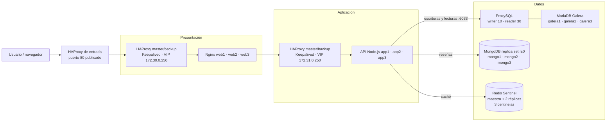

# Sistema distribuido de tres capas

Proyecto académico para la materia **Sistemas Distribuidos**. Tienda web distribuida
con balanceo en presentación y aplicación, almacenamiento relacional y NoSQL, y
caché de catálogo.

**Integrantes:** Javier Rodriguez Rodriguez y Adriana Dzib De la Rosa  
**Docente:** Ismael Jiménez Sánchez — **Tarea:** #995

## Arquitectura

Docker Compose en un solo host: dos pares HAProxy master/backup con Keepalived,
tres nodos web Nginx, tres nodos API Node.js, tres MariaDB Galera detrás de
ProxySQL, replica set MongoDB de tres nodos y Redis con maestro, dos réplicas y
tres centinelas.

### Diagrama



### Responsabilidades

- **Presentación:** HAProxy distribuye entre `web1-3`; Keepalived administra la VIP.
- **Aplicación:** HAProxy distribuye entre `app1-3`; la API ofrece catálogo, reseñas y salud.
- **Datos:** MariaDB Galera almacena el catálogo (ProxySQL enruta); MongoDB `rs0` almacena reseñas; Redis conserva el catálogo más barato durante `CATALOG_CACHE_TTL_SECONDS` (60 s). Si Redis cae, el catálogo se sirve desde MariaDB.

### Alcance y límites

La API usa `DB_HOST=proxysql` (no `galera1`), ProxySQL promueve otro writer si el actual falla. MongoDB y Redis tienen alta disponibilidad local con failover automático. Todo corre en un solo host: **no** protege contra la caída del host, de Docker Desktop, de `presentation-entry` ni de la red local. El objetivo es tolerar la caída de réplicas y procesos dentro del mismo host.

### Objetivos

- **Resiliencia:** el sistema tolera la caída de réplicas de API, nodos Galera, primario de MongoDB y maestro de Redis sin interrumpir el servicio; el catálogo se sirve desde MariaDB si Redis no responde.
- **Alta disponibilidad:** ProxySQL promueve automáticamente otro writer de Galera; MongoDB elige otro primario; Sentinel promueve otra réplica de Redis; HAProxy retira nodos caídos del balanceo.
- **Escalabilidad:** el pool de conexiones se parametriza con `DB_POOL_SIZE` por réplica de API; al escalar réplicas se comprueba que `N × DB_POOL_SIZE` no supere los límites de ProxySQL y MariaDB.

### Mejoras de la capa de datos (implementadas)

Las 7 mejoras solicitadas están implementadas y verificadas:

| # | Mejora | Estado |
|---|---|---|
| 1 | MongoDB replica set / gestionado | ✅ Implementado y verificado |
| 2 | Redis HA / gestionado | ✅ Implementado y verificado |
| 3 | Redis descartable | ✅ Implementado y verificado |
| 4 | Eliminar conexión directa a `galera1` | ✅ Implementado y verificado |
| 5 | Proxy DB-aware | ✅ Implementado y verificado |
| 6 | Enrutamiento lectura/escritura en Galera | ✅ Implementado y verificado |
| 7 | Límites del pool al escalar réplicas | ✅ Implementado y verificado |

**Resultados de failover (23-10-2026):**

| Falla | Resultado |
|---|---|
| Writer Galera `galera3` detenido | ProxySQL promovió `galera2`; escritura insertó 1 fila; catálogo en 200. Al reiniciar, `galera3` recuperó el writer y `size=3`, `Synced`, `Primary`. |
| Primario MongoDB `mongo1` detenido | `mongo2` elegido primario; GET reviews 200, POST 201. Al reiniciar, `mongo1` volvió como primario. |
| Maestro Redis `redis-master` detenido | Sentinel promovió `172.32.0.12`; health `degraded`, catálogo `redis (unavailable) -> mariadb`, cache clear `503`. Al reiniciar, health `ok`. |
| Todos los Redis detenidos | Health `degraded`, catálogo 200 desde MariaDB, cache clear 503. Tras reiniciar, health `ok` y catálogo repobló caché. |
| `galera1` detenido y reiniciado solo | `galera/entrypoint.sh` detectó datos con `safe_to_bootstrap=0` y lo unió al clúster; `wsrep_cluster_size` volvió a 3. |
| MongoDB caído al arrancar `app1` | `app1` arrancó en `degraded` (reseñas 503). Al volver `rs0`, health `ok` y reseñas 200 sin reiniciar la API. |

## Capa de datos

### ProxySQL (MariaDB)

La API y `catalog-init` se conectan a `proxysql:6033`. ProxySQL monitorea el estado `wsrep` y clasifica los nodos:

| Grupo | Uso |
|---|---|
| `10` | Writer (un nodo Synced/Primary) |
| `20` | Backup writer |
| `30` | Reader (nodos sincronizados) |
| `40` | Offline |

`SELECT ... FOR UPDATE` y las escrituras van al grupo `10`; los `SELECT` simples al `30`. Si el writer falla, ProxySQL promueve otro nodo sin cambiar la configuración de la API. Panel de administración: `proxysql:6032` (solo red interna).

### MongoDB replica set (`rs0`)

Tres miembros: `mongo1` (prioridad 2), `mongo2` y `mongo3` (prioridad 1), con keyfile compartido. `catalog-init` crea el usuario `store_app` limitado a `store_reviews`. La API usa `MONGO_HOSTS=mongo1,mongo2,mongo3` y `MONGO_REPLICA_SET=rs0`; el driver descubre al primario y tolera la caída de un nodo. Si el primario se detiene, se elige otro y las reseñas siguen respondiendo. La conexión se intenta en segundo plano; si falla, el cliente se reemplaza para reconectar cuando MongoDB vuelva. `/api/health` marca `mongodb: unavailable` mientras tanto y las reseñas responden `503`, sin afectar el catálogo.

### Redis Sentinel (caché descartable)

Maestro, dos réplicas y tres centinelas con quórum 2. La API se conecta a `redis-sentinel1/2/3:26379` y descubre al maestro (`mymaster`); si el maestro cae, Sentinel promueve una réplica. Redis no usa AOF ni RDB: la caché se reconstruye desde MariaDB. Los centinelas monitorean la IP fija `172.32.0.11` (Docker elimina el DNS de un contenedor detenido y Sentinel entraría en `TILT`). `REDIS_COMMAND_TIMEOUT_MS` (2 s por defecto) limita cada comando de caché; si Redis no responde, el catálogo se lee de MariaDB. `POST /api/cache/clear` devuelve `503` si Redis no está disponible.

### Pool de conexiones

`DB_POOL_SIZE` es el límite por réplica de API. Con 3 réplicas, el máximo es `3 × DB_POOL_SIZE` conexiones, además del monitoreo de ProxySQL. ProxySQL limita al usuario de aplicación a `max_connections=200` y cada servidor Galera a `max_connections=30`.

| Variable | Default | Efecto |
|---|---|---|
| `DB_POOL_SIZE` | 10 | Conexiones por réplica de API |
| `DB_POOL_IDLE_TIMEOUT_MS` | 60000 | Cierre de conexiones inactivas |
| `DB_CONNECT_TIMEOUT_MS` | 5000 | Límite para abrir una conexión |
| `REDIS_COMMAND_TIMEOUT_MS` | 2000 | Límite por comando de caché |
| `CATALOG_CACHE_TTL_SECONDS` | 60 | TTL del catálogo |

## Acceso desde una segunda laptop

El host ejecuta Docker Compose; la otra laptop actúa como **cliente de prueba**. El puerto 80 publicado por Docker se consume usando la IP LAN del host (ej. `http://192.168.1.50/`), no `localhost`.

### Cuándo se necesita el firewall

Docker publica el puerto 80 en `0.0.0.0` por defecto, por lo que el tráfico de la LAN llega al contenedor. **Solo se necesita una regla de firewall si Windows bloquea el tráfico entrante** (interfaz clasificada como `Public`). Si `Test-NetConnection` devuelve `TcpTestSucceeded: True`, no hace falta ninguna regla.

Para verificar conectividad desde el cliente:

```powershell
Test-NetConnection 192.168.1.50 -Port 80
```

Si devuelve `False`, crea una regla restringida (sustituye las IP y el nombre de interfaz por los de tu red):

```powershell
$hostIp = "192.168.1.50"
$clienteIp = "192.168.1.25"
$interfaz = "Wi-Fi"
$perfil = (Get-NetConnectionProfile -InterfaceAlias $interfaz).NetworkCategory
New-NetFirewallRule -DisplayName "Distributed Store HTTP test" -Direction Inbound -Protocol TCP -LocalPort 80 -LocalAddress $hostIp -RemoteAddress $clienteIp -InterfaceAlias $interfaz -Action Allow -Profile $perfil
```

No abras TCP/80 a toda una red pública ni cambies el perfil de red a `Private` solo para la PoC. Nagios está publicado únicamente en `127.0.0.1:8088` y no es accesible desde la LAN.

### Pasos para probar desde el cliente

1. Levanta el stack en el host: `docker compose --env-file .env.exam up --build -d`
2. En el host, obtén su IP LAN: `ipconfig | findstr /i "IPv4"`
3. Desde el cliente, verifica: `Test-NetConnection <IP_HOST> -Port 80`
4. Abre en el navegador del cliente: `http://<IP_HOST>/`
5. Verifica la API: `curl.exe -i http://<IP_HOST>/api/health`

Las pruebas que detienen o inician contenedores se ejecutan en el host; la carga y las comprobaciones HTTP se hacen desde el cliente.

## Ejecución en Windows

**Requisitos:** Windows 10/11 con Docker Desktop, Docker Compose v2, PowerShell, puertos 80 y 8088 libres.

1. Abre PowerShell en la raíz del repositorio.
2. Levanta el stack con las credenciales de demostración:

```powershell
docker compose --env-file .env.exam up --build -d
docker compose --env-file .env.exam ps
```

3. Revisa logs si algún servicio falla:

```powershell
docker compose --env-file .env.exam logs --tail 100 catalog-init db-bootstrap mongo-init proxysql app1 app2 app3 galera1 galera2 galera3 mongo1 mongo2 mongo3 redis-master redis-sentinel1
```

4. Accede a la tienda en `http://localhost/` y a la API en `http://localhost/api/health`.

`galera1` usa `galera/entrypoint.sh` para decidir si arranca el clúster o se une a uno existente. Si hay datos y `safe_to_bootstrap=0`, el nodo se une al clúster en lugar de negarse a arrancar. Solo hace bootstrap cuando no hay datos o cuando fue el último en salir del componente primario. Si todos los nodos están detenidos y ninguno tiene `safe_to_bootstrap=1`, `mysqld` se niega a hacer bootstrap para no perder transacciones; en ese caso respalda los volúmenes y recupera la posición con `wsrep-recover` (ver ToDo.md).

Keepalived corre en sidecars que comparten el namespace de red de cada HAProxy. Después de reconstruirlos o iniciarlos, confirma que los cuatro sidecars sigan activos en `docker compose ps`.

Para detener sin borrar datos: `docker compose --env-file .env.exam down`. Para borrar volúmenes: `docker compose --env-file .env.exam down -v` (destructivo). Redis no tiene volúmenes de persistencia: al recrear sus contenedores la caché arranca vacía.

## PoC 1: Prueba de carga

**Objetivo:** medir la respuesta del catálogo bajo concurrencia.

Desde el cliente (sustituye la IP por la del host):

```powershell
$baseUrl = "http://192.168.1.50"
ab -n 500 -c 20 "$baseUrl/api/products/cheapest"
```

Para medir caché fría:

```powershell
$baseUrl = "http://192.168.1.50"
Invoke-RestMethod -Method Post -Uri "$baseUrl/api/cache/clear"
ab -n 1 -c 1 "$baseUrl/api/products/cheapest"
ab -n 500 -c 20 "$baseUrl/api/products/cheapest"
```

Si no tienes `ab`, usa JMeter con un grupo de hilos, el endpoint `GET /api/products/cheapest`, 20 usuarios y 500 iteraciones.

**Resultados (23-10-2026):**

| Escenario | Solicitudes | Fallidas | Req/s | Tiempo medio |
|---|---|---|---|---|
| Caché fría | 1 | 0 | 107.60 | 9.294 ms |
| Caché caliente | 500 | 0 | 1447.22 | 13.820 ms |

## PoC 2: Failover simple

**Objetivo:** comprobar que HAProxy de aplicación deja de enviar tráfico a un nodo API detenido.

**Desde el cliente:**

```powershell
$baseUrl = "http://192.168.1.50"
curl.exe -i "$baseUrl/api/health"
```

**En el host, detén un nodo API:**

```powershell
docker compose --env-file .env.exam stop app1
```

**Desde el cliente, espera unos segundos y consulta de nuevo** (debe responder `200` con `app2` o `app3` en la traza):

```powershell
curl.exe -i "$baseUrl/api/health"
```

**En el host, recupera el servicio:**

```powershell
docker compose --env-file .env.exam start app1
```

**Desde el cliente, confirma que volvió a responder:**

```powershell
curl.exe -i "$baseUrl/api/health"
```

**Criterio de éxito:** HTTP 200 durante la caída, atendido por los nodos restantes; el nodo detenido se puede iniciar de nuevo.

**Resultados (23-10-2026):**
- Baseline: `HTTP 200`, traza `app2`.
- Con `app1` detenido: 3 solicitudes `HTTP 200`, trazas `app3`, `app2`, `app3`.
- Tras recuperar `app1`: `HTTP 200`, traza `app1`.

## PoC 3: Chaos Engineering 


Inyecta una falla controlada en una réplica API y comprueba que el servicio mantiene disponibilidad:

```powershell
$target = Get-Random -InputObject @("app1", "app2", "app3")
Write-Host "Nodo seleccionado: $target"
docker compose --env-file .env.exam stop $target
try {
    Write-Host "Falla inyectada por 15 segundos; ejecutar sondeos desde el cliente."
    Start-Sleep -Seconds 15
}
finally {
    docker compose --env-file .env.exam start $target
}
```

Durante la ventana, ejecuta comprobaciones desde el cliente: `curl.exe -i http://<IP_HOST>/api/health`.

## Documentación y evidencias

Este README y los archivos Markdown del repositorio constituyen la documentación del proyecto. La capa de datos, los modos de falla y los resultados del 23-10-2026 están descritos en las secciones anteriores. El equipo debe completar los espacios pendientes con el diagrama JPG exportado y las evidencias de las PoC de carga y Chaos Monkey antes de presentar esos resultados como ejecutados.
