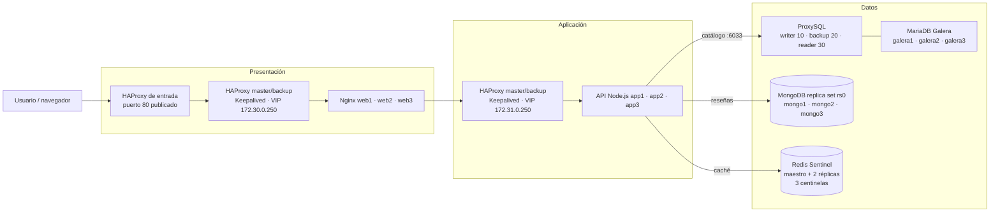
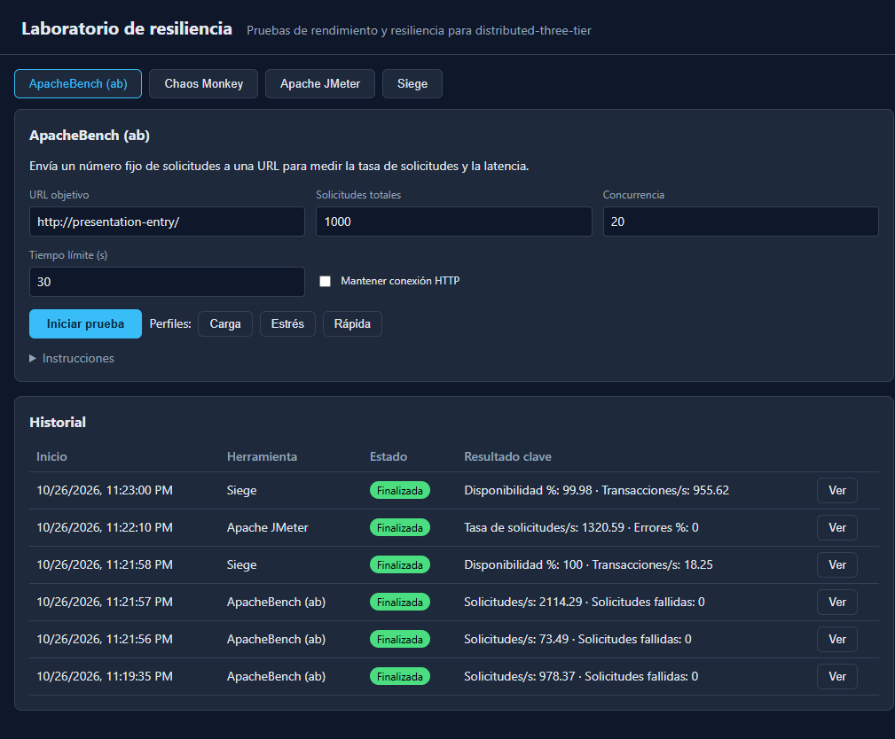

# Sistema distribuido de tres capas

Tienda web distribuida desarrollada para la materia **Sistemas Distribuidos**
(Tarea #995). La solución separa presentación, aplicación y datos, y combina
balanceo con alta disponibilidad, bases replicadas, caché y monitoreo.

**Autores:** Javier Rodriguez Rodriguez y Adriana Dzib De la Rosa  
**Docente:** Ismael Jiménez Sánchez

Javier y Adriana desarrollamos y verificamos el sistema en equipo siguiendo
las indicaciones del docente. Este README presenta la arquitectura, el uso del
stack y el mapa de pruebas; los procedimientos detallados y la evidencia se
mantienen en los documentos enlazados.

## Documentación

| Documento | Contenido |
|---|---|
| [Plan de pruebas](resilience-lab/TEST-PLAN.md) | Casos funcionales, rendimiento, disponibilidad, caos y observabilidad; herramientas y criterios esperados. |
| [Resultados de pruebas](resilience-lab/RESULTADOS-PRUEBAS.md) | Mediciones realizadas, estado de cada área, límites de alcance y evidencia visual. |
| [Resultados de rendimiento en Kubernetes local](deploy/RESULTADOS-RENDIMIENTO-LOCAL.md) | Latencias de catálogo con caché fría/caliente en el perfil Minikube de un nodo. |
| [Guía del laboratorio](resilience-lab/README.md) | Inicio del dashboard, uso de ApacheBench, Siege, JMeter y Chaos Monkey. |
| [Guía de las tres PoC LAN](PoCs/README.md) | Pasos para ejecutar carga, failover por capas y caos con un host y un cliente. |
| [Despliegue local en Kubernetes](deploy/README.md) | Minikube, Kustomize y límites del entorno de desarrollo local. |

## Alcance implementado y límites

Hay dos recorridos locales distintos: el stack original Docker Compose y una
implementación de migración que se ejecuta en Minikube. Para no competir por
memoria, se detiene Compose antes de iniciar Kubernetes; ambos conservan sus
propios datos. El estado verificado de Kubernetes está en el perfil
`distributed-local-one-node`, no en el perfil antiguo de tres nodos.

| Fase del plan | Qué sí está implementado localmente | Qué no demuestra o sigue pendiente |
|---|---|---|
| 0. Aplicación e imágenes | Imágenes locales de web/API, healthchecks y configuración por entorno. | Publicación versionada en GHCR y flujo de releases. |
| 1. Infraestructura | Minikube de un nodo con la aplicación operativa; hay configuración Terraform para K3s/libvirt. | Terraform no se aplicó en VMs; no hay K3s/etcd HA, kube-vip verificado ni backend remoto. Un nodo no es un clúster tolerante a fallas. |
| 2. Kubernetes | Kustomize despliega web/API, MariaDB, MongoDB, Redis y RabbitMQ; sondas, PVC, worker y telemetría funcionan. | Operadores y bases en HA, Ingress productivo, NetworkPolicies probadas y overlays de producción. |
| 3. Colas | RabbitMQ local, reseñas asíncronas, idempotencia, reintentos y DLQ probados con smoke. | RabbitMQ de tres réplicas/quorum, alertas y escalado por profundidad de cola. |
| 4. CI/CD | GitHub Actions ejecuta pruebas, auditorías, builds y validaciones de manifiestos/Terraform. | Publicación en GHCR, firma/SBOM, escaneo de imágenes y despliegue protegido. Que exista el workflow no significa que se hayan desplegado releases. |
| 5. GitOps | Hay código de infraestructura y manifiestos de apoyo para el futuro bootstrap. | Flux no está instalado ni reconciliando este perfil local; no hay promoción entre entornos ni secretos SOPS. |
| 6. Observabilidad | Collector OTel, Grafana/Tempo/Prometheus local, dashboard y trazas de API, datos, Redis, RabbitMQ y worker. | LGTM de producción, alertas completas, SLO, telemetría de clúster y spans propios de Nginx. El backend usa Prometheus en vez de Mimir y consume recursos del host. |
| 7. Seguridad | El namespace usa PSA `baseline` y audita/advierte sobre `restricted`; web/API/worker/Collector usan controles de usuario no root y filesystem de solo lectura donde está configurado. Los secretos locales se generan aparte, se ignoran en Git y usan permisos privados. | Wazuh no está instalado. No se fuerza `restricted` globalmente: los manifiestos actuales de MariaDB/MongoDB aún no definen el contexto restringido requerido y el init container de RabbitMQ usa `CHOWN` para el PVC. Hay que adaptar y probar esos Pods antes de hacer cumplir la política. Tampoco hay RBAC mínimo completo, NetworkPolicies verificadas, TLS de Ingress/mTLS, autenticación/límite de tasa de API ni escaneo de imágenes Trivy. |
| 8. Validación | Smoke de extremo a extremo, medición fría/caliente y respaldo/restauración aislada de MariaDB, MongoDB y definiciones RabbitMQ. | No hay migración de datos Compose, pruebas de caos/SLO en Kubernetes ni respaldo de mensajes en tránsito de RabbitMQ. |

### Wazuh: posibilidad y límite real

Wazuh **sí se puede probar localmente**, pero todavía no forma parte del
despliegue. Una demo de un nodo puede instalar manager, indexer y dashboard,
y un agente para ese nodo; eso sirve para aprender y demostrar ingesta/FIM,
no para probar alta disponibilidad ni cobertura de una flota. El indexer y la
telemetría comparten CPU, RAM y disco con Minikube, la tienda y LGTM; por eso
primero hay que medir el consumo libre y decidir si se reduce o se apaga LGTM
durante la prueba. El agente de un nodo Minikube bajo Docker tampoco equivale
automáticamente a un agente Wazuh instalado en el host Linux: la visibilidad
de archivos del host y los logs de auditoría K3s requieren accesos y una
configuración adicionales. Se dejó pendiente deliberadamente para no presentar
como hecha una integración que no se ha desplegado ni validado.

Los manifiestos de Wazuh, si se agregan, deben ser un overlay opcional y no
parte obligatoria del arranque local; no se debe habilitar acceso privilegiado
al host sin revisar exactamente qué rutas se montan.

### Qué conservar y qué no subir

- `database/catalog.sql` y `deploy/base/catalog.sql` son copias coordinadas:
  CI verifica que coincidan. No se borra una de ellas sin cambiar también la
  inicialización y esa verificación.
- `web/site1`, `site2` y `site3`, HAProxy/Keepalived, Galera/ProxySQL, Nagios,
  `PoCs/` y `resilience-lab/` pertenecen al stack Compose o a sus pruebas y
  guías. No son recursos del overlay Minikube, pero tampoco son basura mientras
  se conserve el proyecto original y su evidencia.
- Se retiró `.DS_Store`, metadata de Finder que no es fuente del proyecto; Git
  ahora la ignora.
- Las carpetas `.terraform/` son descargas/cachés regenerables y están
  ignoradas. El estado `terraform.tfstate` contiene datos sensibles de
  infraestructura y también está ignorado: se conserva localmente, no se
  borra ni se versiona sin revisar su uso.
- `.env.exam` es el archivo de entorno de demostración que usan Compose y la
  creación de Secrets locales. Trátalo solo como configuración de laboratorio:
  `.env.exam` está versionado y Git seguirá registrando sus cambios aunque el
  patrón `.env.*` figure en `.gitignore`; nunca pongas credenciales reales en
  ese archivo ni lo uses fuera del laboratorio.
- Los respaldos locales contienen datos y permanecen fuera del repositorio.

## Arquitectura original en Docker Compose

El diseño original usa Docker Compose en un host. Los pares HAProxy y
Keepalived administran las VIP de presentación y aplicación. La capa de datos
combina MariaDB Galera y ProxySQL para el catálogo, MongoDB Replica Set para
reseñas y Redis Sentinel para la caché descartable.



### Responsabilidades y comportamiento

- **Presentación:** HAProxy distribuye tráfico entre `web1`, `web2` y `web3`;
  Keepalived administra la VIP `172.30.0.250`.
- **Aplicación:** HAProxy distribuye solicitudes entre `app1`, `app2` y `app3`
  mediante la VIP `172.31.0.250`. La API expone catálogo, reseñas y salud.
- **Catálogo:** la API se conecta a ProxySQL (`proxysql:6033`), que enruta
  escrituras a un nodo Galera writer y lecturas a los nodos disponibles.
- **Reseñas:** MongoDB `rs0` elige automáticamente un primario entre sus tres
  miembros.
- **Caché:** Redis Sentinel vigila un maestro y dos réplicas. Si Redis no está
  disponible, el catálogo se consulta en MariaDB; la caché puede reconstruirse.
- **Monitoreo:** Nagios comprueba servicios y endpoints. Las API mantienen
  direcciones fijas `172.31.0.21`–`172.31.0.23` para que una réplica caída
  pueda generar una alerta concreta aunque Docker retire su registro DNS.

| Endpoint o ajuste | Función |
|---|---|
| `http://localhost/` | Tienda web publicada en el puerto 80. |
| `http://localhost/api/health` | Estado de API, MariaDB, MongoDB y Redis. |
| `http://localhost/api/products/cheapest` | Catálogo utilizado en las pruebas de lectura y caché. |
| `http://localhost:8090` | Dashboard local de pruebas; se inicia junto con el laboratorio. |
| `proxysql:6033` / `proxysql:6032` | Puerto de datos de la API / administración interna de ProxySQL. |
| `DB_POOL_SIZE` | Máximo de conexiones de MariaDB por réplica de API. |
| `CATALOG_CACHE_TTL_SECONDS` | Tiempo de vida de la caché del catálogo (60 s por defecto). |
| `REDIS_COMMAND_TIMEOUT_MS` | Límite de espera para comandos Redis (2000 ms por defecto). |

Este diseño tolera fallas de réplicas y procesos dentro del mismo host; no
elimina el punto único de falla del host, Docker Desktop ni del proxy de
entrada. El detalle de la configuración de datos está en
[docker-compose.yml](docker-compose.yml) y en sus directorios de servicio.

La migración gradual a Kubernetes se desarrolla en
[PLATFORM-MIGRATION-PLAN.md](PLATFORM-MIGRATION-PLAN.md). Compose sigue siendo
el entorno local existente; la primera superposición Minikube está documentada
en [deploy/README.md](deploy/README.md).

## Estructura del repositorio

| Ruta | Propósito |
|---|---|
| `docker-compose.yml` | Servicios, redes, volúmenes, healthchecks y políticas de reinicio del stack principal. |
| `application/`, `web/` | API Node.js y nodos web Nginx. |
| `haproxy/`, `keepalived/` | Balanceo, comprobaciones y failover de las VIP. |
| `galera/`, `proxysql/`, `mongo/`, `redis/`, `database/` | Motores de datos, proxy e inicialización del catálogo. |
| `nagios/` | Definiciones de hosts, servicios y alertas locales. |
| `PoCs/` | Tres pruebas guiadas LAN y scripts de readiness, carga, failover y monitoreo. |
| `resilience-lab/` | ApacheBench, Siege, JMeter, Chaos Monkey, dashboard y volumen de resultados. |
| `deploy/` | Base Kustomize, overlay de Minikube local y scripts de construcción y smoke tests. |
| `Start-Stack.ps1`, `Stop-Stack.ps1` | Arranque y apagado ordenado del stack. |
| `Install-AutoStart.ps1` | Instalación o retirada del arranque automático al iniciar sesión. |

## Inicio en Windows

**Requisitos:** Windows 10/11, Docker Desktop con Compose v2 y PowerShell.
Desde PowerShell, en la raíz del repositorio:

```powershell
docker compose --env-file .\.env.exam up -d --build
docker compose --env-file .\.env.exam ps
powershell -NoProfile -ExecutionPolicy Bypass -File .\PoCs\Test-StackHealth.ps1
```

La comprobación de salud debe concluir con **9/9 verificaciones**. La tienda se
publica en `http://localhost/` y la API en
`http://localhost/api/health`. La respuesta esperada es HTTP 200 con
`"status":"ok"` y las dependencias disponibles.

El archivo de entorno de demostración se pasa explícitamente a Compose para
configurar los servicios. No publiques credenciales reales ni las pegues en
capturas o resultados.

Para acceder desde una segunda laptop, obtén la IPv4 LAN del host con
`ipconfig | findstr /i "IPv4"` y usa `http://<IP_HOST>/`. Verifica primero
`Test-NetConnection <IP_HOST> -Port 80`; la guía de PoCs describe la regla de
firewall restringida si Windows bloquea la conexión.

### Iniciar el laboratorio

Con el stack principal en ejecución, inicia las herramientas y el dashboard:

```powershell
docker compose -f .\resilience-lab\docker-compose.yml up -d --build
Start-Process http://localhost:8090
```

El laboratorio se conecta a la red `distributed-three-tier_edge`; conserva el
nombre del proyecto Compose principal o configura `TARGET_PROJECT` de forma
coherente. El dashboard permite definir el destino y parámetros de las pruebas,
consultar el historial y abrir el informe HTML de JMeter. Consulta la
[guía del laboratorio](resilience-lab/README.md) antes de iniciar una prueba
que detenga contenedores.



## Mapa de pruebas

El [plan de pruebas](resilience-lab/TEST-PLAN.md) organiza la verificación en
cinco áreas. El [informe](resilience-lab/RESULTADOS-PRUEBAS.md) distingue lo
medido de los escenarios que no se ejecutaron; el plan define cobertura y no
debe interpretarse por sí solo como evidencia.

| Área | Qué verificamos | Herramientas y evidencia |
|---|---|---|
| 1. Línea base y funcionalidad | Salud de API y dependencias, ruta de catálogo, trazas, balanceo, consistencia Galera, réplica MongoDB y degradación Redis. | `Test-StackHealth.ps1`, pruebas unitarias y comprobaciones del plan. |
| 2. Rendimiento | Humo, carga, efecto de caché, tasa de errores, latencias y prueba sostenida; se documentan aparte los picos o duraciones no cubiertos. | `Invoke-LoadTest.ps1`, ApacheBench, Siege y JMeter. |
| 3. Alta disponibilidad y failover | Réplicas web/API, VIP y procesos HAProxy, Galera/ProxySQL, MongoDB, Redis/Sentinel y restauración tras la falla. | `Test-LanFailover.ps1`, `Invoke-ChaosTest.ps1` y escenarios controlados del informe. |
| 4. Ingeniería del caos | Simulación y fallas controladas de contenedores; el laboratorio permite grupos de balanceo, aplicación, datos y dependencias. | Chaos Monkey, Siege/JMeter y monitoreo de disponibilidad. |
| 5. Observabilidad y alertas | Estado y tiempos de respuesta, eventos locales Nagios y validez de su configuración. | Nagios, logs, `/api/health`, `X-Request-Trace` e informe de resultados. |

Algunos casos del plan tienen impacto importante —por ejemplo, carga de cientos
de usuarios, pérdida total de una capa o cambios de red— y no se ejecutan
automáticamente. Evalúa el alcance, acuerda límites y comprueba la restauración
antes de cada experimento. No se debe inferir que un caso pasó solo porque la
herramienta lo permita.

## Las tres PoC LAN

La carpeta `PoCs/` se conserva porque contiene los scripts ejecutables y las
instrucciones para demostrar el comportamiento desde una segunda laptop. En
cada escenario, el **host** controla Docker y restaura las fallas; el
**cliente** genera tráfico HTTP y registra la respuesta y `X-Request-Trace`.
Los pasos y comandos completos están en la
[guía de PoCs](PoCs/README.md).

1. **Carga:** mide caché fría y caliente, solicitudes por segundo, latencias y
   errores desde el cliente.
2. **Failover por capas:** comprueba una réplica API y el failover de los
   balanceadores de presentación y aplicación.
3. **Caos controlado:** detiene una réplica API durante un intervalo limitado,
   monitorea la disponibilidad y confirma su recuperación.

Las pruebas adicionales del plan —incluidas las herramientas del dashboard,
casos de datos y monitoreo— se explican en la
[guía del laboratorio](resilience-lab/README.md) y se reportan en
[RESULTADOS-PRUEBAS.md](resilience-lab/RESULTADOS-PRUEBAS.md). No se duplican
como PoC independientes porque pertenecen a los escenarios del laboratorio.

## Validación rápida y recuperación

Pruebas reproducibles desde la raíz:

```powershell
npm --prefix .\application test
docker compose --env-file .\.env.exam config --quiet
docker compose -f .\resilience-lab\docker-compose.yml config --quiet
powershell -NoProfile -ExecutionPolicy Bypass -File .\PoCs\Test-StackHealth.ps1
```

Para apagar los servicios sin borrar datos:

```powershell
powershell -NoProfile -ExecutionPolicy Bypass -File .\Stop-Stack.ps1
```

Para iniciarlos de nuevo:

```powershell
powershell -NoProfile -ExecutionPolicy Bypass -File .\Start-Stack.ps1
```

`docker compose stop` conserva contenedores y volúmenes. `docker compose down`
elimina los contenedores; `docker compose down -v` elimina también los
volúmenes persistentes y no se debe usar si se quieren conservar los datos.
Después de un reinicio, comprueba el estado con `Test-StackHealth.ps1` antes de
comenzar una PoC. Si Galera no recupera el quórum, evita un bootstrap manual
sin revisar primero la posición de recuperación y respaldar los datos.

## Resultados y evidencia

El informe de Compose del **26 de octubre de 2026** registra 9/9 comprobaciones
de readiness y 29/29 servicios activos para esa ejecución; no describe el
estado actual de Kubernetes. Para la migración local, Minikube quedó verificado
el **16 de noviembre de 2026**: 11/11 Pods listos, smoke funcional y de
telemetría aprobada, 14/14 pruebas unitarias de API y una medición de
rendimiento descrita en
[los resultados locales](deploy/RESULTADOS-RENDIMIENTO-LOCAL.md). Ninguna de
estas cifras es una garantía de capacidad ni un objetivo SLO.

---

**Proyecto realizado por Javier Rodriguez Rodriguez y Adriana Dzib De la Rosa**
para la materia **Sistemas Distribuidos**, bajo las indicaciones del docente
**Ismael Jiménez Sánchez**.
