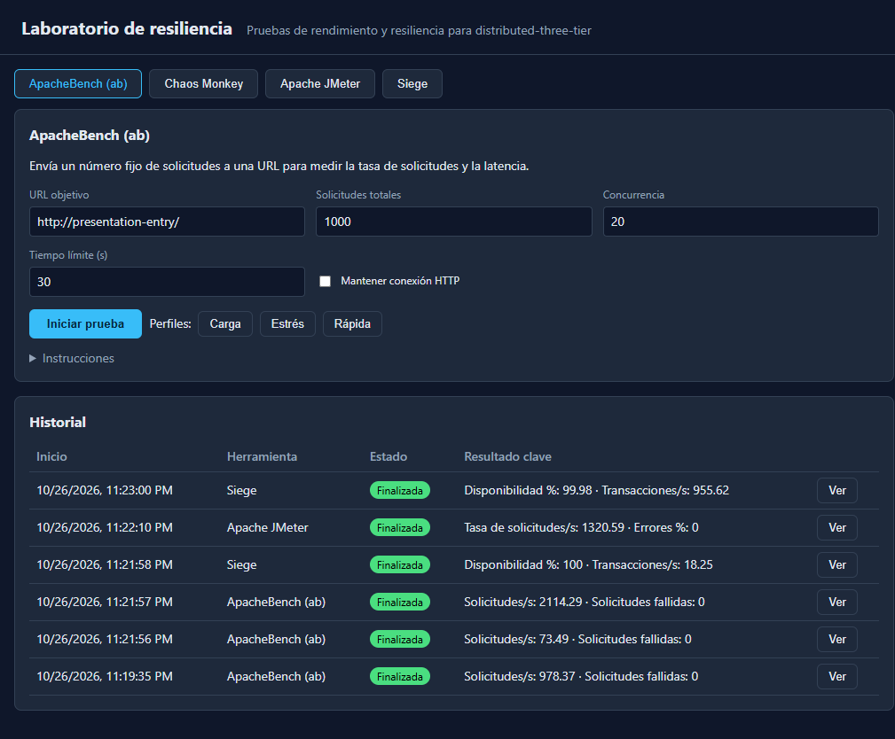

# Resultados de pruebas del sistema distribuido

**Fecha:** 26–27 de octubre de 2026  
**Alcance:** puntos 1–5 de [TEST-PLAN.md](./TEST-PLAN.md).  
**Entorno:** Docker Compose en Windows; tráfico dirigido al stack local.

Este informe registra la ejecución actual. Los resultados etiquetados como
históricos en el plan corresponden a otra fecha y no se usan como evidencia
para esta ejecución. Las pruebas no realizadas se indican expresamente; no se
consideran aprobadas.

## Resumen

| Área del plan | Resultado |
|---|---|
| 1. Línea base y funcionalidad | **APROBADA**: 9/9 comprobaciones de readiness; 29/29 servicios principales activos. |
| 2. Rendimiento | **COMPLETADA para el alcance aprobado**: soak limpio de 30 minutos, carga acotada y presión de CPU limitada a una API. Se excluyeron deliberadamente las pruebas de saturación y carga de hasta 300 usuarios. |
| 3. Alta disponibilidad y failover | **COMPLETADA para los escenarios acordados**: balanceadores, réplicas web/API, HAProxy, Sentinel, ProxySQL y aislamiento de una réplica Galera conservaron o recuperaron el servicio según lo esperado. |
| 4. Ingeniería del caos | **PARCIAL**: Chaos Monkey se ejecutó en simulación y se hicieron fallas manuales acotadas. No se hicieron particiones de Galera en dos segmentos, latencia ni pérdida de paquetes. |
| 5. Observabilidad y alertas | **APROBADA para alerta local**: Nagios ya registra la caída de `app3` como `CRITICAL`; su preflight pasó con 0 advertencias y 0 errores. No se envió ni se probó correo. |

## 1. Línea base y comprobaciones funcionales

La comprobación final de `Test-StackHealth.ps1` terminó con **9/9 PASS**:

- Docker responde y los **29/29 servicios** del stack principal están `Up`.
- `/api/health` devuelve HTTP 200 con `status=ok` y MariaDB, MongoDB y Redis disponibles.
- `/api/products/cheapest` devuelve HTTP 200.
- La traza atraviesa `presentation-lb-master`, `webnode2`,
  `application-lb-master`, `app2`, MariaDB, MongoDB y Redis.
- Galera informa `wsrep_cluster_size=3`, `Primary` y `Synced`.
- Las VIP `172.30.0.250` y `172.31.0.250` están en sus balanceadores master.
- El puerto TCP de Nagios acepta conexiones.

También se verificó la distribución de `X-Request-Trace` entre réplicas web y
API. Una fila temporal escrita en un nodo Galera se leyó desde los tres nodos;
la fila se eliminó al terminar. Una reseña temporal aceptó `POST` con HTTP 201
y apareció en `GET`; también se eliminó.

La respuesta degradada se probó deteniendo los seis contenedores Redis: la API
respondió HTTP 200 con estado `degraded` y Redis `unavailable`, el catálogo
siguió respondiendo HTTP 200 desde MariaDB y `/api/cache/clear` respondió HTTP
503. Después de iniciar Redis, la salud volvió a `ok`.

Las pruebas unitarias de la aplicación terminaron con **11/11 aprobadas**.
La configuración de Compose del stack y del laboratorio validó sin errores.

## 2. Rendimiento

| Herramienta y escenario | Resultado observado |
|---|---|
| ApacheBench, humo: 100 solicitudes, concurrencia 5 | 0 errores; 978.37 solicitudes/s; p50 3 ms; p95 26 ms. |
| ApacheBench, caché fría: 1 solicitud | 13.607 ms de latencia media (73.49 solicitudes/s). |
| ApacheBench, caché caliente: 500 solicitudes, concurrencia 20 | 0 solicitudes fallidas y 0 respuestas no-2xx; 2114.29 solicitudes/s; p50 7 ms; p95 15 ms. |
| Siege, humo: 5 usuarios, unos 10 s | 200 transacciones; 0 fallidas; 100 % de disponibilidad. |
| JMeter: 5 hilos, 15 s | 19,727 muestras; 0 errores; 1320.59 solicitudes/s; p95 6 ms; p99 9 ms. |
| Siege durante failover: 20 usuarios, 120 s | 115,315 transacciones exitosas y 20 fallidas; 99.98 % de disponibilidad; 955.62 transacciones/s. |
| Siege sostenido: 5 usuarios, 1800.54 s | 17,529 transacciones exitosas, 5 fallidas (HTTP 503); 99.97 % de disponibilidad; 9.74 transacciones/s; tiempo de respuesta medio 0.01 s. Se ejecutó en paralelo con las fallas controladas de esta ronda. |
| Siege sostenido limpio: 5 usuarios, demora de 1 s, 1800.82 s | **17,746 transacciones**, 0 fallidas, 100 % de disponibilidad y 9.85 transacciones/s. No se inyectaron fallas durante esta repetición. |

Los valores son mediciones de esta ejecución local, no garantías de capacidad
ni SLO. La primera prueba sostenida coincidió con inyecciones de fallos y
registró cinco respuestas HTTP 503; por ello se repitió sin inyecciones. El
soak limpio de 30 minutos terminó con 0 errores. No se ejecutaron una
resistencia de varias horas, el aumento hasta saturación, el pico de 5 a 300
usuarios ni pruebas de carga aisladas por capa.

Como prueba acotada de presión en un solo contenedor, `app3` tuvo un límite
temporal de 0.5 CPU y 512 MiB de memoria durante 20 segundos de trabajo CPU
intensivo. `docker stats` observó 49.72 % de CPU y 68.63 MiB (13.40 % del límite
de memoria); mientras tanto, la API compartida siguió en `status=ok`. Se recreó
`app3` al terminar para restablecer sus límites originales sin restricciones.
En una carga separada con Siege, 15 usuarios solicitaron
`GET /api/products/cheapest` durante 60 segundos: **71,665 transacciones**, 0
fallidas, 100 % de disponibilidad y 1188.28 transacciones/s. Siege alcanzó
107 % de CPU (aprox. 1.07 núcleos); las API mostraron picos de 22–47 % cada
una, memoria de cada API de aprox. 61–107 MiB y MongoDB hasta aprox. 402 MiB.
No se intentó saturar el host.

## 3. Alta disponibilidad y failover

| Falla inyectada | Resultado |
|---|---|
| Pausa del master del balanceador de presentación, bajo carga | PASS. Failover de VIP en 10.39 s; failback en 4.30 s. |
| Pausa del master del balanceador de aplicación, bajo carga | PASS. Failover de VIP en 10.24 s; failback en 4.32 s. |
| Detención de `app1` | PASS tras repetir la fase API con la espera de recuperación corregida: HAProxy lo detectó como `DOWN` en 6.27 s y como `UP` 2.41 s después de restaurarlo. 7 de 8 sondeos durante la falla respondieron HTTP 200; la traza final volvió a estar completa. |
| Detención del writer Galera que ProxySQL reportaba como `ONLINE` (`galera3`) | PASS. ProxySQL promovió `galera2`; una escritura enviada por ProxySQL durante el failover se replicó en `galera1` y `galera2`. La fila de prueba quedó eliminada en los tres nodos. Al restaurar `galera3`, Galera volvió a tamaño 3. |
| Detención del primario MongoDB `mongo1` | PASS. `mongo2` asumió como primario; el catálogo y las reseñas siguieron operativos. Al restaurar `mongo1`, el replica set recuperó su estado. |
| Detención de los seis contenedores Redis | PASS para degradación controlada. El catálogo siguió disponible desde MariaDB; al restaurar Redis, la salud volvió a `ok`. |
| Detención de un secundario MongoDB (`mongo3`) | PASS. `mongo1` siguió `PRIMARY`, `mongo2` siguió `SECONDARY`, la API mantuvo `status=ok`; al iniciar `mongo3`, volvió a `SECONDARY`. |
| Detención de una réplica Redis (`redis-replica1`) | PASS. Sentinel conservó el maestro `172.32.0.11:6379`, la salud Redis siguió `ok` y, al restaurarla, el estado continuó `ok`. |
| Aislamiento de `app3` de la red de aplicación | PASS. Durante la desconexión HAProxy registró `app3 is DOWN`; 12/12 sondeos respondieron HTTP 200 y ninguno pasó por `app3`. Tras reconectar la red, HAProxy registró `app3 is UP` y la API volvió a `ok`. |
| Aislamiento con IP estática de `app3` y prueba de alerta Nagios | PASS. La API usa `172.31.0.21–23`, fuera del rango dinámico. Al detener `app3`, Nagios registró `SERVICE ALERT ... CRITICAL ... 172.31.0.23:8080`; la API compartida siguió saludable. Se deshabilitaron notificaciones mientras se probaba, luego se restauraron. |
| Caída simultánea de los dos balanceadores de aplicación | PASS de la prueba de fallo y recuperación. Sin ambos HAProxy/Keepalived, el endpoint local no fue accesible (curl HTTP `000`); al restaurarlos, `/api/health` volvió a `status=ok`. |
| Caída simultánea de los dos balanceadores de presentación | PASS de la prueba de fallo y recuperación. Con ambos nodos detenidos, el endpoint local no fue accesible (curl HTTP `000`); la salud volvió a `ok` tras restaurarlos. |
| Detención simultánea de `app1` y `app2` | PASS. La solicitud respondió HTTP 200 y la traza pasó únicamente por `app3`; ambas réplicas se iniciaron y la API quedó saludable. |
| Detención simultánea de `web1` y `web2` | PASS. La solicitud respondió HTTP 200 a través de `webnode3`; ambas réplicas se iniciaron y la API quedó saludable. |
| Pausa de los procesos HAProxy master, capa de aplicación y presentación | PASS. Keepalived movió cada VIP al backup; la traza confirmó `application-lb-backup` y `presentation-lb-backup` respectivamente. Al reanudar los procesos, ambas VIP volvieron al master y la API siguió en `ok`. |
| Detención de dos Sentinel | PASS. Tras esperar el intervalo de detección, `SENTINEL CKQUORUM mymaster` devolvió `NOQUORUM` con un Sentinel disponible. Redis siguió respondiendo a la API; al restaurar ambos Sentinel, `CKQUORUM` volvió a `OK` y la API siguió saludable. |
| Detención de ProxySQL | PASS. El catálogo y el endpoint de salud respondieron HTTP 503 mientras ProxySQL estaba detenido. Tras iniciarlo, `/api/health` volvió a `status=ok`. |
| Aislamiento de `galera2` de la red de base de datos | PASS, sin partición 2/1. Durante 10 s, `galera1` y `galera3` conservaron `wsrep_cluster_size=2` y estado `Primary`; ProxySQL mantuvo `galera3` `ONLINE` como writer y la API quedó en `ok`. Al reconectar `galera2`, el clúster volvió a 3 nodos `Primary`. |

Los escenarios de alta disponibilidad aprobados para esta ronda quedaron
ejecutados. La interrupción total de una capa de balanceo se comportó como una
pérdida temporal del punto de entrada, tal como se esperaba; los servicios
internos se recuperaron al restaurar los nodos.

## 4. Ingeniería del caos

Se ejecutó Chaos Monkey con `GROUP=app`, `DRY_RUN=true`, intervalo y tiempo de
indisponibilidad de 1 s, y duración configurada de 5 s. El modo en seco
registró **4 acciones `stop(dry-run)` y sus 4 restauraciones simuladas**, sin
detener contenedores. Durante los 7 sondeos, hubo **0 fallidos**, 100 % de
disponibilidad y 8.6 ms de latencia media.

Además del modo en seco, se ejecutaron fallas manuales y controladas de
balanceadores, réplicas API/web, ProxySQL, Sentinel y una réplica Galera, así
como presión de CPU limitada a un contenedor. No se ejecutó Chaos Monkey en
modo de inyección real. Tampoco se probaron particiones de Galera en dos
segmentos, latencia o pérdida de paquetes, saturación del host, disco, desfase
de reloj, lentitud artificial de dependencias ni recuperación después de
detener todo el stack.

## 5. Observabilidad y alertas

Se corrigió la comprobación de API de Nagios para apuntar a IPs estáticas
(`172.31.0.21`, `.22`, `.23`), de modo que la caída del contenedor no dependa de
la resolución DNS dinámica de Docker. Los objetos supervisados ahora incluyen
el contacto `nagiosadmin`. Después de recargar Nagios, el preflight informó
**0 errores y 0 advertencias** para los 23 hosts y 24 servicios. El plugin
`check_http` respondió HTTP 200 al consultar directamente `172.31.0.23:8080`.

En una prueba de falla controlada, las notificaciones globales se desactivaron
y se verificó ese estado en `statusjson.cgi` antes de detener `app3`. Nagios
registró `SERVICE ALERT: app3;Application HTTP;CRITICAL;HARD` con
`No route to host`; la API siguió operativa. `app3` se restauró y las
notificaciones globales quedaron habilitadas. El contacto configurado conserva
el correo de plantilla `nagios@localhost`; por petición del usuario no se
envió ni se validó correo electrónico. Por tanto, queda demostrada la alerta
local, no el transporte externo.

## Evidencia visual

Captura del panel del laboratorio con el historial de ejecuciones de
rendimiento:



La captura muestra el panel y sus resultados guardados; no reemplaza los
registros detallados de cada ejecución.

## Repetición de las comprobaciones finales

Desde PowerShell, en la raíz del repositorio:

```powershell
npm --prefix .\application test
docker compose --env-file .\.env.exam config --quiet
docker compose -f .\resilience-lab\docker-compose.yml config --quiet
.\PoCs\Test-StackHealth.ps1 -ComposeEnvFile .env.exam
```

Al finalizar esta ejecución, los **29/29 servicios principales** estaban en
ejecución y los cinco contenedores del laboratorio seguían iniciados.
